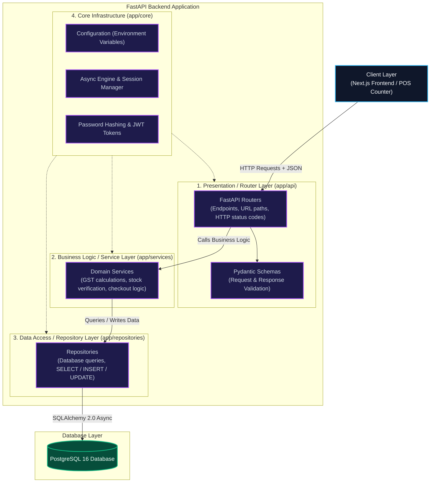

# PartShop — Backend Architecture & Milestone Learning Roadmap

> **Document Purpose**: Official architectural specification, Clean Layered design patterns, and step-by-step milestone learning roadmap for the FastAPI backend.  
> **Source of Truth**: Codebase (`d:/Programming/PartShop`)  
> **Governance**: Maintained according to rules established in `AGENTS.md`.  
> **Last Updated**: 2026-11-22  

---

## 1. Architectural Philosophy & Learning Principles

This backend is designed with two core goals in mind:
1. **Production-Ready Clean Architecture**: High performance, strict data integrity, type-safety, and secure authentication.
2. **Pedagogical Clarity (Learning-First)**:
   - **Simplicity over cleverness**: No overly complex abstractions, metaprogramming, or cryptic shortcuts.
   - **Clean separation of concerns**: Every file has a single, easy-to-understand purpose.
   - **Thoroughly commented code**: Concepts like asynchronous programming, dependency injection, and data validation are explained in plain language.

---

## 2. High-Level System Architecture

The backend follows a **4-Layer Clean Architecture**:

---

## 3. The 8-Milestone Roadmap & Progress Tracker

This tracker tracks our step-by-step progress. Each milestone builds directly on the previous one.

| Milestone | Title | Objective & Concepts Covered | Status |
| :--- | :--- | :--- | :--- |
| **Milestone 0** | **Environment & Pip Setup** | Set up `backend/`, virtual environment (`.venv`), and `requirements.txt`. Understand async Python drivers and pinned dependencies. | `Completed` |
| **Milestone 1** | **Core Foundation & First API** | `config.py` (Pydantic settings), `database.py` (Async session factory), and `main.py` (FastAPI instance, CORS, `/health`). Run Uvicorn and explore Swagger UI (`/docs`). | `Completed` |
| **Milestone 2** | **Database Models & Alembic Migrations** | Define SQLAlchemy models (`User`, `SparePart`, `Supplier`, `Mechanic`). Set up Alembic and run async database migrations. | `Completed` |
| **Milestone 3** | **Security & Authentication (JWT + RBAC)** | Password hashing (bcrypt), generating JWT tokens, FastAPI Dependency Injection (`get_current_user`), and role-based guards (`ADMIN`, `STAFF`). | `Completed` |
| **Milestone 4** | **Clean Architecture & Spare Parts Catalog** | Implement the Repository Pattern and Service Layer for Spare Parts. Search by bike model, barcode, part number with pagination. | `Completed` |
| **Milestone 5** | **Atomic POS Billing Engine** | Implement atomic transactions with row-level locking (`SELECT ... FOR UPDATE`), stock decrementing, GST calculation, and mechanic commissions. | `Completed` |
| **Milestone 6** | **Excel Bulk Import & Reports** | Parse and validate `.xlsx` catalogs with bulk database inserts. Daily sales summaries and profit margin reports. | `Completed` |
| **Milestone 7** | **Docker Containerization & Frontend Link** | Create `backend/Dockerfile`, connect the backend container to `docker-compose.yml`, and test end-to-end communication with the Next.js UI. | `Completed` |

---

## 4. Detailed Milestone Breakdown

### Milestone 0: Environment & Pip Setup
- **Goal**: Establish an isolated Python development workspace without polluting system libraries.
- **Files**:
  - `backend/requirements.txt`: Pin exact production dependencies (`fastapi`, `uvicorn`, `sqlalchemy`, `asyncpg`, `pydantic-settings`, etc.).
- **What you'll learn**:
  - Why virtual environments are essential in Python.
  - The purpose of each library in our stack.

### Milestone 1: Core Foundation & First API
- **Goal**: Get the FastAPI server running and connecting to PostgreSQL.
- **Files**:
  - `backend/app/core/config.py`: Reads variables from `.env` using Pydantic `BaseSettings`.
  - `backend/app/core/database.py`: Sets up SQLAlchemy 2.0 `create_async_engine` and session dependency.
  - `backend/main.py`: Creates the FastAPI application, CORS configuration, and a `/health` endpoint.
- **What you'll learn**:
  - What `async` and `await` mean in Python web servers.
  - How FastAPI automatically generates interactive OpenAPI documentation (`/docs`).

### Milestone 2: Database Models & Alembic Migrations
- **Goal**: Map relational database tables using Python classes and manage migrations safely.
- **Files**:
  - `backend/app/models/base.py`: Shared base class and timestamp mixins (`created_at`, `updated_at`).
  - `backend/app/models/user.py`: User model and roles (`ADMIN`, `MANAGER`, `STAFF`).
  - `backend/app/models/spare_part.py`: Inventory tables with barcodes, prices, and rack locations.
  - `backend/alembic/`: Alembic configuration for async PostgreSQL migrations.
- **What you'll learn**:
  - The difference between ORM models (database tables) and Pydantic schemas (HTTP request/response bodies).
  - Why migrations are superior to manually running SQL queries in production.

### Milestone 3: Security & Authentication (JWT + RBAC)
- **Goal**: Protect endpoints so only authenticated cashiers and managers can access specific data.
- **Files**:
  - `backend/app/core/security.py`: Password hashing with `bcrypt` and JWT issuance.
  - `backend/app/schemas/auth.py`: Pydantic models for login requests and token responses.
  - `backend/app/api/deps.py`: FastAPI dependencies to extract and verify JWT tokens from request headers.
  - `backend/app/api/v1/endpoints/auth.py`: `/login` and `/me` routes.
- **What you'll learn**:
  - How stateless JWT authentication works.
  - How FastAPI Dependency Injection (`Depends(...)`) keeps code clean and modular.

### Milestone 4: Clean Architecture & Spare Parts Catalog
- **Goal**: Implement tokenized search and stock management using the Repository Pattern.
- **Files**:
  - `backend/app/repositories/base.py`: Generic repository for common CRUD operations.
  - `backend/app/repositories/spare_part_repo.py`: Tokenized multi-attribute search engine with automotive synonym dictionary (`filter` ↔ `filt`, `brake` ↔ `brk`, `cushion` ↔ `shock`, etc.) and cross-column SQL `AND` matching.
  - `backend/app/services/inventory_service.py`: Business rules for managing stock.
  - `backend/app/api/v1/endpoints/spare_parts.py`: REST endpoints supporting multi-token queries up to 500 items per page.
- **What you'll learn**:
  - Why keeping database queries out of route handlers prevents technical debt.
  - How to handle tokenized multi-field searches and domain synonym expansions without external heavy search clusters.

### Milestone 5: Atomic POS Billing Engine
- **Goal**: Build the core financial transaction engine of the spare parts shop.
- **Files**:
  - `backend/app/models/sale.py`: Sales invoice, sale line items, and payment modes.
  - `backend/app/models/stock_movement.py`: Immutable audit ledger for every stock change.
  - `backend/app/services/billing_service.py`: Atomic checkout transaction with row-level locks.
  - `backend/app/api/v1/endpoints/billing.py`: POS checkout endpoint.
- **What you'll learn**:
  - What ACID transactions are and why row-level locking (`SELECT FOR UPDATE`) prevents race conditions.
  - How to calculate GST (CGST/SGST) and mechanic commissions dynamically.

### Milestone 6: Excel Bulk Import & Reports
- **Goal**: Provide shop owners with easy bulk data onboarding and business insights.
- **Files**:
  - `backend/app/services/import_service.py`: Reads `.xlsx` files, validates rows, and bulk-inserts.
  - `backend/app/api/v1/endpoints/reports.py`: Daily sales totals, top-selling parts, and low-stock alerts.
- **What you'll learn**:
  - Handling file uploads in FastAPI (`UploadFile`).
  - Aggregating metrics using SQL group-by and sum functions.

### Milestone 7: Docker Containerization & Frontend Link
- **Goal**: Package the backend into a lightweight Docker image and connect it to the Next.js UI.
- **Files**:
  - `backend/Dockerfile`: Multi-stage Python build.
  - Root `docker-compose.yml`: Enable the backend service.
- **What you'll learn**:
  - Optimizing Python Docker images for fast build times and minimal footprint.
  - Connecting Next.js client-side fetchers to FastAPI endpoints.
