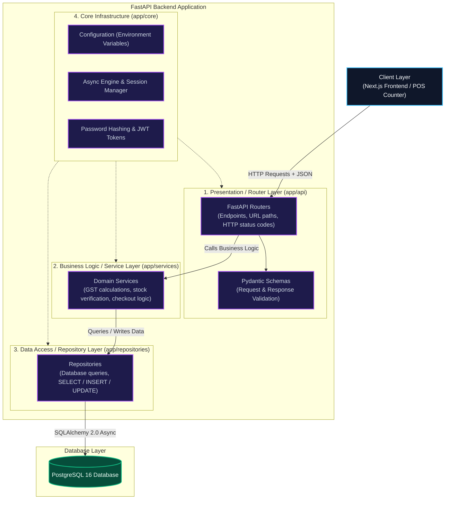
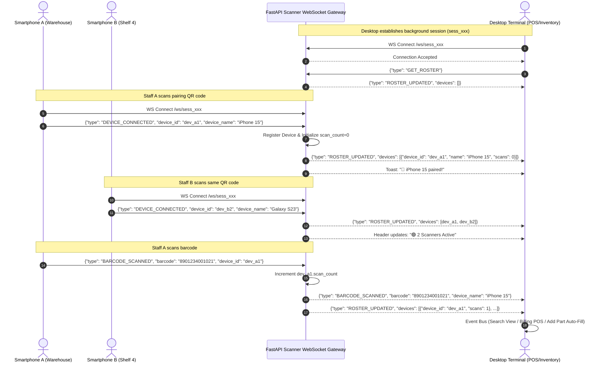
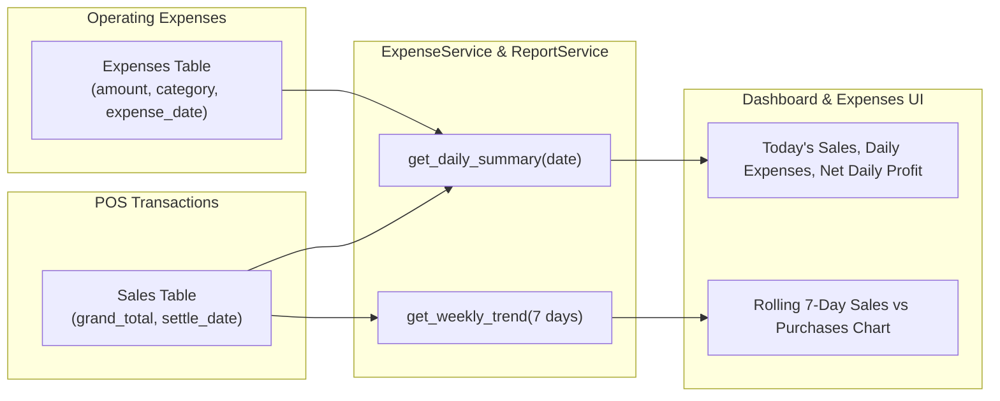
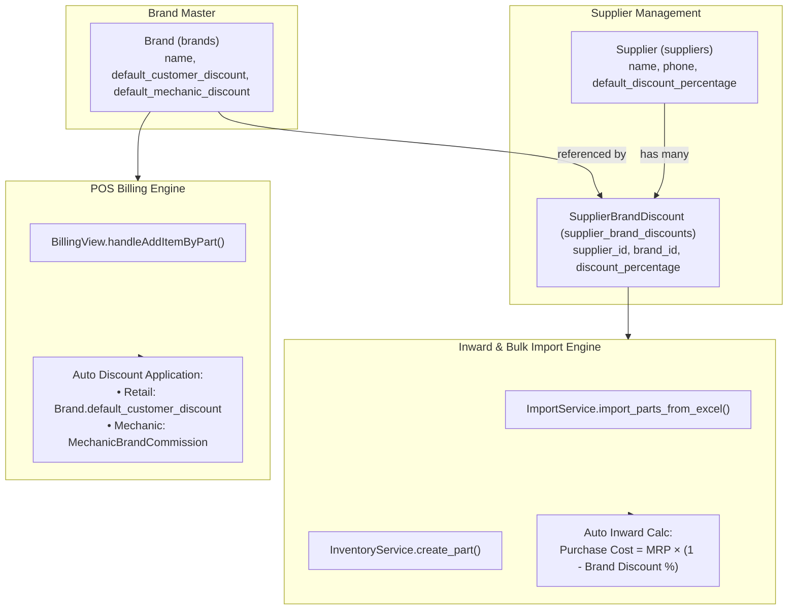
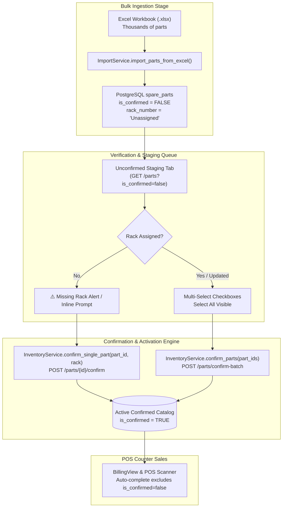
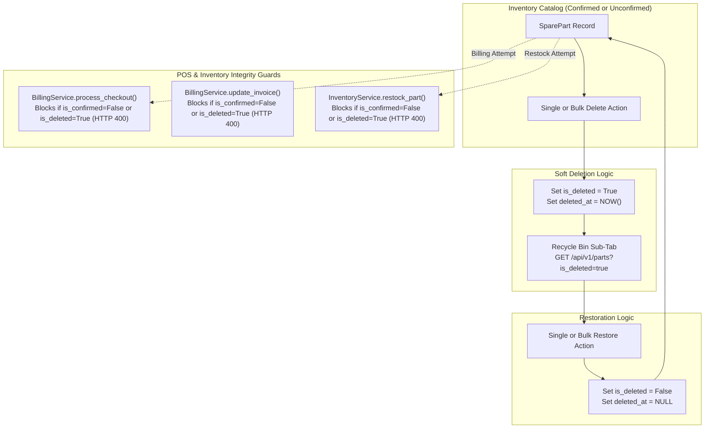

# PartShop — Backend Architecture & Milestone Learning Roadmap

> **Document Purpose**: Official architectural specification, Clean Layered design patterns, and step-by-step milestone learning roadmap for the FastAPI backend.  
> **Source of Truth**: Codebase (`d:/Programming/PartShop`)  
> **Governance**: Maintained according to rules established in `AGENTS.md`.  
> **Last Updated**: 2026-11-26  

---

## 1. Architectural Philosophy & Learning Principles

This backend is designed with two core goals in mind:
1. **Production-Ready Clean Architecture**: High performance, strict data integrity, type-safety, and secure authentication.
2. **Pedagogical Clarity (Learning-First)**:
   - **Simplicity over cleverness**: No overly complex abstractions, metaprogramming, or cryptic shortcuts.
   - **Clean separation of concerns**: Every file has a single, easy-to-understand purpose.
   - **Thoroughly commented code**: Concepts like asynchronous programming, dependency injection, and data validation are explained in plain language.

---

## 2. High-Level System Architecture

The backend follows a **4-Layer Clean Architecture**:

---

## 3. The 8-Milestone Roadmap & Progress Tracker

This tracker tracks our step-by-step progress. Each milestone builds directly on the previous one.

| Milestone | Title | Objective & Concepts Covered | Status |
| :--- | :--- | :--- | :--- |
| **Milestone 0** | **Environment & Pip Setup** | Set up `backend/`, virtual environment (`.venv`), and `requirements.txt`. Understand async Python drivers and pinned dependencies. | `Completed` |
| **Milestone 1** | **Core Foundation & First API** | `config.py` (Pydantic settings), `database.py` (Async session factory), and `main.py` (FastAPI instance, CORS, `/health`). Run Uvicorn and explore Swagger UI (`/docs`). | `Completed` |
| **Milestone 2** | **Database Models & Alembic Migrations** | Define SQLAlchemy models (`User`, `SparePart`, `Supplier`, `Mechanic`). Set up Alembic and run async database migrations. | `Completed` |
| **Milestone 3** | **Security & Authentication (JWT + RBAC)** | Password hashing (bcrypt), generating JWT tokens, FastAPI Dependency Injection (`get_current_user`), and role-based guards (`ADMIN`, `STAFF`). | `Completed` |
| **Milestone 4** | **Clean Architecture & Spare Parts Catalog** | Implement the Repository Pattern and Service Layer for Spare Parts. Search by bike model, barcode, part number with pagination. | `Completed` |
| **Milestone 5** | **Atomic POS Billing Engine** | Implement atomic transactions with row-level locking (`SELECT ... FOR UPDATE`), stock decrementing, GST calculation, and mechanic commissions. | `Completed` |
| **Milestone 6** | **Excel Bulk Import & Reports** | Parse and validate `.xlsx` catalogs with bulk database inserts. Daily sales summaries and profit margin reports. | `Completed` |
| **Milestone 7** | **Docker Containerization & Frontend Link** | Create `backend/Dockerfile`, connect the backend container to `docker-compose.yml`, and test end-to-end communication with the Next.js UI. | `Completed` |
| **Milestone 8** | **Wholesale Supplier Management & Purchase Discounts** | Multi-supplier purchase discount mapping, Excel upload under supplier, and supplier item query endpoints. | `Completed` |
| **Milestone 9** | **Mobile Barcode Scanner Gateway & Fast Goods Inward** | Real-time WebSocket connection hub, host LAN IP discovery, and atomic restock API with audit ledger logging. | `Completed` |

---

## 4. Detailed Milestone Breakdown

### Milestone 0: Environment & Pip Setup
- **Goal**: Establish an isolated Python development workspace without polluting system libraries.
- **Files**:
  - `backend/requirements.txt`: Pin exact production dependencies (`fastapi`, `uvicorn`, `sqlalchemy`, `asyncpg`, `pydantic-settings`, etc.).
- **What you'll learn**:
  - Why virtual environments are essential in Python.
  - The purpose of each library in our stack.

### Milestone 1: Core Foundation & First API
- **Goal**: Get the FastAPI server running and connecting to PostgreSQL.
- **Files**:
  - `backend/app/core/config.py`: Reads variables from `.env` using Pydantic `BaseSettings`.
  - `backend/app/core/database.py`: Sets up SQLAlchemy 2.0 `create_async_engine` and session dependency.
  - `backend/main.py`: Creates the FastAPI application, CORS configuration, and a `/health` endpoint.
- **What you'll learn**:
  - What `async` and `await` mean in Python web servers.
  - How FastAPI automatically generates interactive OpenAPI documentation (`/docs`).

### Milestone 2: Database Models & Alembic Migrations
- **Goal**: Map relational database tables using Python classes and manage migrations safely.
- **Files**:
  - `backend/app/models/base.py`: Shared base class and timestamp mixins (`created_at`, `updated_at`).
  - `backend/app/models/user.py`: User model and roles (`ADMIN`, `MANAGER`, `STAFF`).
  - `backend/app/models/spare_part.py`: Inventory tables with barcodes, prices, and rack locations.
  - `backend/alembic/`: Alembic configuration for async PostgreSQL migrations.
- **What you'll learn**:
  - The difference between ORM models (database tables) and Pydantic schemas (HTTP request/response bodies).
  - Why migrations are superior to manually running SQL queries in production.

### Milestone 3: Security & Authentication (JWT + RBAC)
- **Goal**: Protect endpoints so only authenticated cashiers and managers can access specific data.
- **Files**:
  - `backend/app/core/security.py`: Password hashing with `bcrypt` and JWT issuance.
  - `backend/app/schemas/auth.py`: Pydantic models for login requests and token responses.
  - `backend/app/api/deps.py`: FastAPI dependencies to extract and verify JWT tokens from request headers.
  - `backend/app/api/v1/endpoints/auth.py`: `/login` and `/me` routes.
- **What you'll learn**:
  - How stateless JWT authentication works.
  - How FastAPI Dependency Injection (`Depends(...)`) keeps code clean and modular.

### Milestone 4: Clean Architecture & Spare Parts Catalog
- **Goal**: Implement tokenized search and stock management using the Repository Pattern.
- **Files**:
  - `backend/app/repositories/base.py`: Generic repository for common CRUD operations.
  - `backend/app/repositories/spare_part_repo.py`: Tokenized multi-attribute search engine with automotive synonym dictionary (`filter` ↔ `filt`, `brake` ↔ `brk`, `cushion` ↔ `shock`, etc.) and cross-column SQL `AND` matching.
  - `backend/app/services/inventory_service.py`: Business rules for managing stock.
  - `backend/app/api/v1/endpoints/spare_parts.py`: REST endpoints supporting multi-token queries up to 500 items per page.
- **What you'll learn**:
  - Why keeping database queries out of route handlers prevents technical debt.
  - How to handle tokenized multi-field searches and domain synonym expansions without external heavy search clusters.

### Milestone 5: Atomic POS Billing Engine
- **Goal**: Build the core financial transaction engine of the spare parts shop.
- **Files**:
  - `backend/app/models/sale.py`: Sales invoice, sale line items, payment modes, and `SaleStatus` (`COMPLETED`, `VOIDED`).
  - `backend/app/models/stock_movement.py`: Immutable audit ledger for every stock change (`OUT`, `IN`, `RETURN_IN`, `ADJUSTMENT`).
  - `backend/app/services/billing_service.py`: Atomic checkout transaction with row-level locks, date-range/status invoice querying (`list_invoices`), full invoice and line-item editing with automatic inventory synchronization (`update_invoice`), and atomic cancellation/voiding with inventory return reversal (`cancel_invoice`).
  - `backend/app/api/v1/endpoints/billing.py`: POS checkout endpoint, invoice listing with date/status filters, line item & header updates via `PUT /billing/invoices/{invoice_id}`, and `POST /billing/invoices/{invoice_id}/cancel`.
- **What you'll learn**:
  - What ACID transactions are and why row-level locking (`SELECT FOR UPDATE`) prevents race conditions during checkout, item edits, and return reversals.
  - How to calculate GST (CGST/SGST) and mechanic commissions dynamically.
  - How `update_invoice` compares previous vs new item quantities under pessimistic row locks:
    - Increments inventory and logs `RETURN_IN` (`SALE_EDIT`) when quantities are reduced or items are deleted.
    - Validates availability, decrements inventory, and logs `SALE_OUT` (`SALE_EDIT`) when quantities are increased or items added.
    - Cascades `delete-orphan` line items and refreshes session cache (`expire_all()`).
  - How to reverse sales via `cancel_invoice`: lock spare parts, increment stock, create `RETURN_IN` stock movements, mark `Sale.status = VOIDED`, and record cancellation audit reasons.
  - How downstream financial reports (daily sales, expenses profit calculation, top selling parts, mechanic commissions) exclude `VOIDED` records.

### Milestone 6: Excel Bulk Import & Reports
- **Goal**: Provide shop owners with easy bulk data onboarding and business insights.
- **Files**:
  - `backend/requirements.txt`: Pins `openpyxl==3.1.5`, required by the Excel import service.
  - `backend/app/services/import_service.py`: Reads `.xlsx` files, validates rows, and bulk-inserts.
  - `backend/app/api/v1/endpoints/reports.py`: Daily sales totals, top-selling parts, and low-stock alerts.
- **What you'll learn**:
  - Handling file uploads in FastAPI (`UploadFile`).
  - Aggregating metrics using SQL group-by and sum functions.
  - Rebuild the backend image after dependency changes so the container installs the updated requirements.

### Milestone 7: Docker Containerization & Frontend Link
- **Goal**: Package the backend into a lightweight Docker image and connect it to the Next.js UI.
- **Files**:
  - `backend/Dockerfile`: Multi-stage Python build.
  - Root `docker-compose.yml`: Enable the backend service.
- **What you'll learn**:
  - Optimizing Python Docker images for fast build times and minimal footprint.
  - Connecting Next.js client-side fetchers to FastAPI endpoints.

### Milestone 8: Wholesale Supplier Management & Purchase Discounts
- **Goal**: Allow shop owners to manage multi-supplier relationships with distinct purchase discount rates, upload catalogs under specific suppliers, and query supplier item ledgers.
- **Files**:
  - `backend/app/models/supplier.py`: `Supplier` entity with GSTIN, contact details, and `default_discount_percentage`.
  - `backend/app/models/spare_part.py`: Added `supplier_id`, `supplier_name`, and `supplier_discount` attributes.
  - `backend/alembic/versions/a5c007d4e19b_create_suppliers_table_and_add_supplier_.py`: Alembic migration for PostgreSQL.
  - `backend/app/services/supplier_service.py`: Supplier CRUD operations and aggregate parts counting.
  - `backend/app/services/import_service.py`: Enhanced to map uploaded parts to selected suppliers with purchase discount calculation.
  - `backend/app/api/v1/endpoints/suppliers.py`: Endpoints for supplier management and `GET /{id}/parts`.
- **What you'll learn**:
  - Managing foreign key relationships with `SET NULL` on delete to preserve historical parts data.
  - Combining SQL aggregations (`func.count`) with group-by queries to provide instantaneous supplier catalog counts.

### Milestone 9: Mobile Barcode Scanner Gateway & Fast Goods Inward
- **Goal**: Implement bidirectional WebSocket communication to turn any mobile phone into a wireless scanner, and build atomic restock APIs for fast goods inward logging.
- **Files**:
  - `backend/app/core/websocket.py`: `ScannerConnectionManager` tracking real-time paired sessions and broadcasting scan events.
  - `backend/app/api/v1/endpoints/scanner.py`: WebSocket endpoint `/api/v1/scanner/ws/{session_id}` and LAN IP discovery route `/network-info`.
  - `backend/app/schemas/spare_part.py`: `SparePartRestock` schema.
  - `backend/app/services/inventory_service.py`: `restock_part` method updating quantity and writing `StockMovement` entries (`PURCHASE_IN`).
  - `backend/app/api/v1/endpoints/spare_parts.py`: `POST /parts/{id}/restock`.
- **What you'll learn**:
  - Managing stateful WebSocket connection pools in asynchronous FastAPI servers.
  - Auto-discovering local network interfaces (`socket.gethostbyname_ex`) for cross-device mobile pairing over Wi-Fi.

---

## 10. Multi-Device Wireless Mobile Scanner Gateway & WebSocket Hub

### 10.1 Multi-Client Session Architecture
The scanner gateway (`ScannerConnectionManager`) maintains active rooms partitioned by `session_id`. Multiple mobile scanner clients (different staff members on the warehouse floor) and desktop terminals can join the same session simultaneously:

### 10.2 Network Discovery & Docker Bridge Exclusion
When running in Docker containers, internal bridge networks (`172.16.0.0/12`) cannot be reached by external smartphones. The `/scanner/network-info` route:
1. Detects `HOST_LAN_IP` environment variable set in `docker-compose.yml` (`192.168.1.9`).
2. Strictly filters out all virtual bridge subnets (`172.16.x.x` through `172.31.x.x`) and loopback addresses.
3. Automatically falls back to host Wi-Fi IP `192.168.1.9` if running inside an isolated container without host network mode.
4. Provides only reachable physical LAN IP addresses for pairing QR code generation.

---

## 11. Shop Expenditure & Net Profit Engine

### 11.1 Architecture & Domain Models
The Expenditure module provides operational overhead tracking and real-time net daily profit computation ($\text{Total Sales Revenue} - \text{Total Expenses}$):

### 11.2 Key Components
- **Model**: `app/models/expense.py` (`Expense` model with `ExpenseCategory` enum: `RENT`, `ELECTRICITY`, `TEA_REFRESHMENT`, `SALARY_WAGES`, `MAINTENANCE`, `TRANSPORT`, `STATIONERY`, `OTHER`).
- **Repository**: `app/repositories/expense_repo.py` (`ExpenseRepository` implementing date-range querying, category-wise aggregation, and CRUD).
- **Service**: `app/services/expense_service.py` (`ExpenseService` calculating `DailyExpenseSummary` with `total_expense`, category breakdown, `total_sales`, and `estimated_profit`).
- **Endpoints**: `app/api/v1/endpoints/expenses.py` (`POST /api/v1/expenses`, `GET /api/v1/expenses`, `GET /api/v1/expenses/daily-summary`, `DELETE /api/v1/expenses/{id}`).
- **Permissions**: `GET /api/v1/reports/daily-sales` and `GET /api/v1/reports/weekly-trend` granted to `ADMIN`, `STORE_MANAGER`, and `COUNTER_STAFF` to enable live counter dashboard updates on bill settlement.

---

## 12. Multi-Brand Supplier Discount Matrix & Brand Selling Engine

### 12.1 Normalized Brand Discount Matrix Architecture
To support wholesalers who supply multiple brands at different discount rates (e.g. Hero at 22%, Honda at 18%, Bajaj at 25%), the architecture utilizes a normalized relational bridge table:

### 12.2 Key Components
- **Models**:
  - `app/models/supplier.py`: `SupplierBrandDiscount` with composite unique constraint `(supplier_id, brand_id)`.
  - `app/models/brand.py`: `default_customer_discount` and `default_mechanic_discount` attributes.
- **Service Logic**:
  - `SupplierService.get_effective_discount()`: Evaluates supplier brand matrix with fallback to supplier base discount.
  - `ImportService.import_parts_from_excel()`: Pre-caches supplier discount matrix and brand default discounts in lock-free memory, auto-computing dealer cost and default customer discounts per row without database locking.
  - `InventoryService.create_part()`: Automatically infers purchase discount and selling discounts during single-part entry.

---

## 13. Inventory Confirmation & Bulk Staging Lifecycle Engine

### 13.1 Staging Queue Architecture
To guarantee that unverified bulk spreadsheet uploads cannot be accidentally billed before warehouse staff verify rack shelf locations and selling prices, the backend implements a two-stage catalog lifecycle:

### 13.2 Key Components
- **Model**: `app/models/spare_part.py` (`is_confirmed` indexed boolean column, default `True`).
- **Repository**: `app/repositories/spare_part_repo.py` (`search_parts` supporting `is_confirmed: bool | None`).
- **Service Layer**:
  - `ImportService`: Sets `is_confirmed = False` on all rows created from Excel workbooks so they route to staging.
  - `InventoryService.confirm_parts(part_ids: list[int])`: Efficient bulk update setting `is_confirmed = True` across selected part IDs.
  - `InventoryService.confirm_single_part(part_id: int, rack_number: str | None)`: Validates and updates rack location before activating the part.
- **API Endpoints**:
  - `GET /api/v1/parts?is_confirmed=true/false`: Filter catalog by confirmation state.
  - `POST /api/v1/parts/confirm-batch`: Batch confirmation endpoint.
  - `POST /api/v1/parts/{part_id}/confirm`: Single part confirm with optional rack assignment.

---

## 14. Soft Deletion, Recycle Bin & Sales Integrity Engine

### 14.1 Soft Delete & Audit Preservation Pattern
To ensure past sales records and invoice audit trails are never broken by deleting parts, spare parts utilize soft deletion:
- Parts are flagged with `is_deleted = True` and timestamped with `deleted_at = NOW()`.
- Foreign keys in `sale_items` remain valid and intact.
- Soft-deleted items are isolated in a dedicated Recycle Bin tab and excluded from active catalog listings and searches.

### 14.2 Key Components
- **Model**: `app/models/spare_part.py` (`is_deleted` indexed boolean column, default `False`, and `deleted_at` nullable timestamptz).
- **Repository**: `app/repositories/spare_part_repo.py` (`search_parts` supporting `is_deleted: bool = False`, `get_by_barcode` and `get_by_part_number` with `include_deleted: bool = False`).
- **Service Layer**:
  - `InventoryService.delete_part(part_id: int)`: Soft deletes individual part.
  - `InventoryService.delete_parts_batch(part_ids: list[int])`: Atomic batch soft delete.
  - `InventoryService.restore_part(part_id: int)`: Restores individual part to active catalog.
  - `InventoryService.restore_parts_batch(part_ids: list[int])`: Atomic batch restore.
  - `BillingService.process_checkout()`: Validates that every part in the basket is confirmed and not deleted.
  - `SupplierService.get_supplier_parts()`: Excludes soft-deleted parts and orders by `created_at DESC` for daily inward analysis.
- **API Endpoints**:
  - `DELETE /api/v1/parts/{part_id}`: Soft delete single part.
  - `POST /api/v1/parts/delete-batch`: Batch soft delete.
  - `POST /api/v1/parts/{part_id}/restore`: Restore single part.
  - `POST /api/v1/parts/restore-batch`: Batch restore.
  - `GET /api/v1/parts?is_deleted=true`: Query Recycle Bin.
