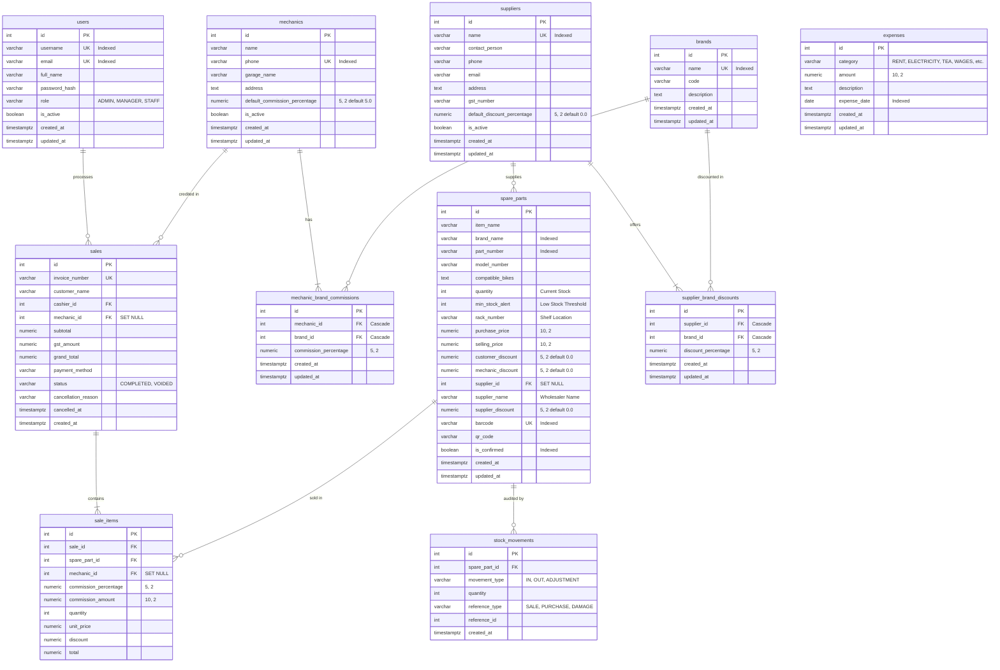

# PartShop — Database Architecture & Entity Design Specification

> **Document Purpose**: Database schema specification, Entity-Relationship diagrams, indexing strategies, constraints, and migration governance.  
> **Source of Truth**: Codebase (`d:/Programming/PartShop`)  
> **Governance**: Maintained according to rules established in `AGENTS.md`.  
> **Last Updated**: 2026-11-26  

---

## 1. Database Architecture Overview

PartShop uses **PostgreSQL 16** containerized via Docker with persistent volume storage (`partshop-pgdata`).
- **ORM**: SQLAlchemy 2.0 (using modern `DeclarativeBase` and `Mapped[T]` type annotations).
- **Driver**: `asyncpg` (high-performance asynchronous driver).
- **Migration Framework**: Alembic (configured for async migrations).
- **Naming Convention**: `snake_case` for tables and columns; singular table entity concepts (`users`, `spare_parts`).

---

## 2. Entity-Relationship Diagram (ERD)

---

## 3. Milestone 2 Core Entities Specification

### 3.1 `users` Table
Stores system cashiers, store managers, and administrators.

| Column | Type | Constraints | Description |
| :--- | :--- | :--- | :--- |
| `id` | `INTEGER` | `PRIMARY KEY`, `AUTO_INCREMENT` | Unique user identifier |
| `username` | `VARCHAR(50)` | `UNIQUE`, `NOT NULL`, `INDEXED` | Login username |
| `email` | `VARCHAR(255)` | `UNIQUE`, `NOT NULL`, `INDEXED` | Contact email |
| `full_name` | `VARCHAR(100)` | `NOT NULL` | Employee full name |
| `password_hash`| `VARCHAR(255)` | `NOT NULL` | Bcrypt hashed password |
| `role` | `VARCHAR(20)` | `NOT NULL`, Default: `'STAFF'` | `ADMIN`, `STORE_MANAGER`, `COUNTER_STAFF` |
| `is_active` | `BOOLEAN` | `NOT NULL`, Default: `TRUE` | Soft-deactivation flag |
| `created_at` | `TIMESTAMPTZ` | `NOT NULL`, Default: `NOW()` | Record creation timestamp (UTC) |
| `updated_at` | `TIMESTAMPTZ` | `NOT NULL`, Default: `NOW()` | Automatic update timestamp (UTC) |

### 3.2 `spare_parts` Table
Stores the inventory catalog, pricing tiers, barcodes, and bin/rack locations.

| Column | Type | Constraints | Description |
| :--- | :--- | :--- | :--- |
| `id` | `INTEGER` | `PRIMARY KEY`, `AUTO_INCREMENT` | Unique part identifier |
| `item_name` | `VARCHAR(150)` | `NOT NULL` | Name of the spare part |
| `brand_name`| `VARCHAR(100)` | `NOT NULL`, `INDEXED` | Manufacturer (e.g. Hero, Bajaj, Bosch) |
| `part_number`| `VARCHAR(100)`| `NOT NULL`, `INDEXED` | OEM/Aftermarket part number |
| `model_number`| `VARCHAR(100)`| `NULLABLE` | Engine or chassis series |
| `compatible_bikes` | `TEXT` | `NULLABLE` | Searchable list of compatible motorcycles |
| `quantity` | `INTEGER` | `NOT NULL`, Default: `0` | Physical stock on hand |
| `min_stock_alert` | `INTEGER` | `NOT NULL`, Default: `5` | Reorder threshold alert |
| `rack_number`| `VARCHAR(50)` | `NULLABLE` | Physical shop bin / rack locator |
| `purchase_price` | `NUMERIC(10, 2)` | `NOT NULL` | Cost of acquisition from supplier |
| `selling_price` | `NUMERIC(10, 2)` | `NOT NULL` | Counter retail price |
| `customer_discount` | `NUMERIC(5, 2)` | `NOT NULL`, Default: `0.00` | Retail customer discount percentage |
| `mechanic_discount` | `NUMERIC(5, 2)` | `NOT NULL`, Default: `0.00` | Registered garage mechanic discount |
| `supplier_id` | `INTEGER` | `NULLABLE`, `FK -> suppliers.id (SET NULL)` | Mapped wholesale supplier distributor |
| `supplier_name` | `VARCHAR(100)` | `NULLABLE` | Cached supplier name for fast listing |
| `supplier_discount` | `NUMERIC(5, 2)` | `NOT NULL`, Default: `0.00` | Supplier purchase discount rate provided to shop |
| `barcode` | `VARCHAR(100)` | `UNIQUE`, `NULLABLE`, `INDEXED` | Scannable POS barcode |
| `qr_code` | `VARCHAR(255)` | `NULLABLE` | QR Code locator identifier |
| `is_confirmed` | `BOOLEAN` | `NOT NULL`, Default: `TRUE`, `INDEXED` | Confirmation staging flag (False=unconfirmed bulk upload) |
| `created_at` | `TIMESTAMPTZ` | `NOT NULL`, Default: `NOW()` | Record creation timestamp (UTC) |
| `updated_at` | `TIMESTAMPTZ` | `NOT NULL`, Default: `NOW()` | Automatic update timestamp (UTC) |

### 3.3 `sales` Table
Stores POS counter sales invoices, cashier details, tax breakdown, and payment methods.

| Column | Type | Constraints | Description |
| :--- | :--- | :--- | :--- |
| `id` | `INTEGER` | `PRIMARY KEY`, `AUTO_INCREMENT` | Unique sale identifier |
| `invoice_number` | `VARCHAR(50)` | `UNIQUE`, `NOT NULL`, `INDEXED` | Unique invoice code (e.g. `INV-20261124-001`) |
| `customer_name` | `VARCHAR(100)` | `NULLABLE` | Walk-in or counter customer name |
| `customer_phone` | `VARCHAR(20)` | `NULLABLE` | Customer mobile number |
| `cashier_id` | `INTEGER` | `NOT NULL`, `FK -> users.id` | Staff member who processed the transaction |
| `mechanic_id` | `INTEGER` | `NULLABLE`, `FK -> mechanics.id (SET NULL)` | Mechanic partner credited for this transaction |
| `subtotal` | `NUMERIC(10, 2)` | `NOT NULL` | Total before tax and discounts |
| `discount_amount`| `NUMERIC(10, 2)` | `NOT NULL`, Default: `0.00` | Total discount applied |
| `tax_amount` | `NUMERIC(10, 2)` | `NOT NULL`, Default: `0.00` | Calculated GST amount (CGST + SGST) |
| `grand_total` | `NUMERIC(10, 2)` | `NOT NULL` | Final billed amount paid by customer |
| `payment_method` | `VARCHAR(20)` | `NOT NULL`, Default: `'CASH'` | `CASH`, `CARD`, `UPI`, `CREDIT` |
| `status` | `VARCHAR(20)` | `NOT NULL`, `INDEXED`, Default: `'COMPLETED'` | `COMPLETED`, `VOIDED` |
| `cancellation_reason` | `VARCHAR(255)` | `NULLABLE` | Audit reason why the invoice was cancelled |
| `cancelled_at` | `TIMESTAMPTZ` | `NULLABLE` | Timestamp when the invoice was voided and items returned |
| `created_at` | `TIMESTAMPTZ` | `NOT NULL`, Default: `NOW()` | Checkout timestamp (UTC) |
| `updated_at` | `TIMESTAMPTZ` | `NOT NULL`, Default: `NOW()` | Timestamp (UTC) |

### 3.4 `sale_items` Table
Line items inside a sales invoice.

| Column | Type | Constraints | Description |
| :--- | :--- | :--- | :--- |
| `id` | `INTEGER` | `PRIMARY KEY`, `AUTO_INCREMENT` | Unique line item ID |
| `sale_id` | `INTEGER` | `NOT NULL`, `FK -> sales.id` | Parent invoice ID |
| `spare_part_id` | `INTEGER` | `NOT NULL`, `FK -> spare_parts.id` | Part that was sold |
| `mechanic_id` | `INTEGER` | `NULLABLE`, `FK -> mechanics.id (SET NULL)` | Attributed mechanic partner for this line item |
| `commission_percentage` | `NUMERIC(5, 2)` | `NOT NULL`, Default: `0.00` | Resolved commission percentage applied for part brand |
| `commission_amount` | `NUMERIC(10, 2)` | `NOT NULL`, Default: `0.00` | Computed mechanic payout amount for this item |
| `quantity` | `INTEGER` | `NOT NULL` | Number of units sold |
| `unit_price` | `NUMERIC(10, 2)` | `NOT NULL` | Unit price at time of sale |
| `discount_percent` | `NUMERIC(5, 2)` | `NOT NULL`, Default: `0.00` | Discount applied to item |
| `total_price` | `NUMERIC(10, 2)` | `NOT NULL` | Final line total: `(unit_price * qty) - discount` |

### 3.5 `stock_movements` Table (Immutable Audit Ledger)
Audit trail tracking every single inventory increment or decrement.

| Column | Type | Constraints | Description |
| :--- | :--- | :--- | :--- |
| `id` | `INTEGER` | `PRIMARY KEY`, `AUTO_INCREMENT` | Unique ledger event ID |
| `spare_part_id` | `INTEGER` | `NOT NULL`, `FK -> spare_parts.id` | Item being adjusted |
| `movement_type` | `VARCHAR(20)` | `NOT NULL` | `SALE_OUT`, `PURCHASE_IN`, `RETURN_IN`, `ADJUSTMENT` |
| `quantity_change` | `INTEGER` | `NOT NULL` | Change amount (negative for sales, positive for restock) |
| `balance_after` | `INTEGER` | `NOT NULL` | Resulting inventory balance |
| `reference_type` | `VARCHAR(50)` | `NULLABLE` | `SALE`, `PURCHASE`, `DAMAGE` |
| `reference_id` | `INTEGER` | `NULLABLE` | Foreign invoice or PO reference number |
| `created_at` | `TIMESTAMPTZ` | `NOT NULL`, Default: `NOW()` | Timestamp when movement took place |

### 3.6 `brands` Table
Master manufacturer and aftermarket spares catalog brands.

| Column | Type | Constraints | Description |
| :--- | :--- | :--- | :--- |
| `id` | `INTEGER` | `PRIMARY KEY`, `AUTO_INCREMENT` | Unique brand identifier |
| `name` | `VARCHAR(100)` | `UNIQUE`, `NOT NULL`, `INDEXED` | Brand title (Hero, Bajaj, TVS, Honda, etc.) |
| `code` | `VARCHAR(50)` | `NULLABLE` | Short manufacturer code |
| `description` | `TEXT` | `NULLABLE` | Brand description and category |
| `default_customer_discount` | `NUMERIC(5, 2)` | `NOT NULL`, Default: `0.00` | Automated retail selling discount at POS counter |
| `default_mechanic_discount` | `NUMERIC(5, 2)` | `NOT NULL`, Default: `0.00` | Fallback mechanic partner discount rate |
| `created_at` | `TIMESTAMPTZ` | `NOT NULL`, Default: `NOW()` | Timestamp (UTC) |
| `updated_at` | `TIMESTAMPTZ` | `NOT NULL`, Default: `NOW()` | Timestamp (UTC) |

### 3.7 `mechanics` Table
Registered garage and technician partners.

| Column | Type | Constraints | Description |
| :--- | :--- | :--- | :--- |
| `id` | `INTEGER` | `PRIMARY KEY`, `AUTO_INCREMENT` | Unique mechanic identifier |
| `name` | `VARCHAR(100)` | `NOT NULL` | Mechanic full name |
| `phone` | `VARCHAR(20)` | `UNIQUE`, `NOT NULL`, `INDEXED` | Contact telephone / mobile |
| `garage_name` | `VARCHAR(150)` | `NULLABLE` | Garage or workshop trade name |
| `address` | `TEXT` | `NULLABLE` | Physical shop address |
| `default_commission_percentage` | `NUMERIC(5, 2)` | `NOT NULL`, Default: `5.00` | Fallback commission rate across unlisted brands |
| `is_active` | `BOOLEAN` | `NOT NULL`, Default: `TRUE` | Soft-deletion and active toggle |
| `created_at` | `TIMESTAMPTZ` | `NOT NULL`, Default: `NOW()` | Timestamp (UTC) |
| `updated_at` | `TIMESTAMPTZ` | `NOT NULL`, Default: `NOW()` | Timestamp (UTC) |

### 3.8 `mechanic_brand_commissions` Table
Customized brand-specific commission override rates per mechanic partner.

| Column | Type | Constraints | Description |
| :--- | :--- | :--- | :--- |
| `id` | `INTEGER` | `PRIMARY KEY`, `AUTO_INCREMENT` | Unique override ID |
| `mechanic_id` | `INTEGER` | `NOT NULL`, `FK -> mechanics.id (CASCADE)` | Associated mechanic |
| `brand_id` | `INTEGER` | `NOT NULL`, `FK -> brands.id (CASCADE)` | Associated brand |
| `commission_percentage` | `NUMERIC(5, 2)` | `NOT NULL` | Custom commission % for this brand |
| `created_at` | `TIMESTAMPTZ` | `NOT NULL`, Default: `NOW()` | Timestamp (UTC) |
| `updated_at` | `TIMESTAMPTZ` | `NOT NULL`, Default: `NOW()` | Timestamp (UTC) |
| *Constraint* | `UNIQUE(mechanic_id, brand_id)` | `NOT NULL` | One rate per mechanic-brand pair |

### 3.9 `suppliers` Table
Wholesale suppliers and authorized spare parts distributors.

| Column | Type | Constraints | Description |
| :--- | :--- | :--- | :--- |
| `id` | `INTEGER` | `PRIMARY KEY`, `AUTO_INCREMENT` | Unique supplier identifier |
| `name` | `VARCHAR(100)` | `UNIQUE`, `NOT NULL`, `INDEXED` | Distributor or wholesale agency trade name |
| `contact_person`| `VARCHAR(100)` | `NULLABLE` | Primary account manager or representative |
| `phone` | `VARCHAR(20)` | `NOT NULL` | Business telephone or mobile contact |
| `email` | `VARCHAR(100)` | `NULLABLE` | Business communication & billing email |
| `address` | `TEXT` | `NULLABLE` | Warehouse or showroom physical address |
| `gst_number` | `VARCHAR(20)` | `NULLABLE` | GSTIN tax registration compliance identifier |
| `default_discount_percentage` | `NUMERIC(5, 2)` | `NOT NULL`, Default: `0.00` | Default wholesale discount rate offered to shop |
| `is_active` | `BOOLEAN` | `NOT NULL`, Default: `TRUE` | Operational active status flag |
| `created_at` | `TIMESTAMPTZ` | `NOT NULL`, Default: `NOW()` | Record creation timestamp (UTC) |
| `updated_at` | `TIMESTAMPTZ` | `NOT NULL`, Default: `NOW()` | Timestamp (UTC) |

### 3.10 `expenses` Table
Shop operational overhead and daily counter expenditure ledger (Migration: `e7c2a1f4b89d`).

| Column | Type | Constraints | Description |
| :--- | :--- | :--- | :--- |
| `id` | `INTEGER` | `PRIMARY KEY`, `AUTO_INCREMENT` | Unique expense transaction ID |
| `category` | `ENUM(ExpenseCategory)` | `NOT NULL` | `RENT`, `ELECTRICITY`, `TEA_REFRESHMENT`, `SALARY_WAGES`, `MAINTENANCE`, `TRANSPORT`, `STATIONERY`, `OTHER` |
| `amount` | `NUMERIC(10, 2)` | `NOT NULL` | Expense cost amount in INR (`₹`) |
| `description` | `TEXT` | `NULLABLE` | Optional context, vendor, or purpose remarks |
| `expense_date` | `DATE` | `NOT NULL`, `INDEXED` | Transaction accounting date |
| `created_at` | `TIMESTAMPTZ` | `NOT NULL`, Default: `NOW()` | Creation timestamp (UTC) |
| `updated_at` | `TIMESTAMPTZ` | `NOT NULL`, Default: `NOW()` | Last modification timestamp (UTC) |

### 3.11 `supplier_brand_discounts` Table
Multi-brand wholesale purchase discount matrix per distributor (Migration: `b8e4f1a2c3d5`).

| Column | Type | Constraints | Description |
| :--- | :--- | :--- | :--- |
| `id` | `INTEGER` | `PRIMARY KEY`, `AUTO_INCREMENT` | Unique override record ID |
| `supplier_id` | `INTEGER` | `NOT NULL`, `FK -> suppliers.id (CASCADE)` | Wholesaler providing the rate |
| `brand_id` | `INTEGER` | `NOT NULL`, `FK -> brands.id (CASCADE)` | Manufacturer brand being discounted |
| `discount_percentage` | `NUMERIC(5, 2)` | `NOT NULL` | Purchase discount % (e.g. 22.00% for Hero) |
| `created_at` | `TIMESTAMPTZ` | `NOT NULL`, Default: `NOW()` | Record creation timestamp (UTC) |
| `updated_at` | `TIMESTAMPTZ` | `NOT NULL`, Default: `NOW()` | Timestamp (UTC) |
| *Constraint* | `UNIQUE(supplier_id, brand_id)` | `NOT NULL` | Exactly one discount rate per supplier-brand pair |

---

## 4. Indexing & Optimization Strategy

1. **Barcode / SKU Lookups**: Fast point-of-sale scanning requires `< 5ms` queries. An explicit `B-tree index` is placed on `spare_parts.barcode` and `spare_parts.part_number`.
2. **Brand & Filter Queries**: `spare_parts.brand_name` is indexed to accelerate sidebar catalog filtering in the POS view.
3. **Authentication Queries**: `users.username` and `users.email` have unique B-tree indexes for fast credential lookups during cashier sign-in.
4. **Catalog Confirmation Staging Queries**: `spare_parts.is_confirmed` has a B-tree index (`ix_spare_parts_is_confirmed`) to rapidly separate confirmed catalog parts from staging queue bulk imports without scanning the full table.

---

## 5. Migration History

| Version Revision | Name / Purpose | Applicable Tables |
| :--- | :--- | :--- |
| `0932c0fa0f57` | Initial migration schema | `users`, `brands`, `mechanics`, `suppliers`, `spare_parts`, `sales`, `sale_items`, `stock_movements` |
| `b8e4f1a2c3d5` | Supplier brand discounts & brand default discounts | `supplier_brand_discounts`, `brands.default_customer_discount`, `brands.default_mechanic_discount` |
| `e7c2a1f4b89d` | Daily shop operational expenditures | `expenses` |
| `c9d5e2f1a8b4` | Invoice cancellation, voiding & return audit | `sales.status`, `sales.cancellation_reason`, `sales.cancelled_at` |
| `d1e8f3a5b7c9` | Spare parts confirmation & staging queue | `spare_parts.is_confirmed` (boolean, default true, indexed) |
