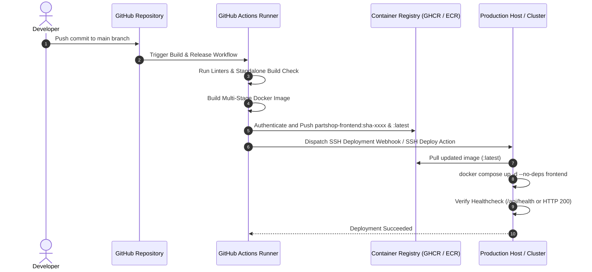

# PartShop — Deployment Architecture & Operations Runbook

> **Document Purpose**: Technical deployment specification, infrastructure topology, CI/CD pipeline design, environment configuration management, and release runbooks.  
> **Source of Truth**: Active codebase (`d:/Programming/PartShop`)  
> **Governance**: Maintained according to rules established in `AGENTS.md`.  
> **Last Updated**: 2026-11-20  

---

## 1. Deployment Philosophy & Architecture Overview

PartShop is designed for reproducible containerized deployments using multi-stage Docker builds and Docker Compose orchestration. The deployment strategy follows a **Twelve-Factor App** methodology:

1. **Immutable Build Artifacts**: The Next.js frontend container contains pre-compiled standalone artifacts (`.next/standalone`). The same image built in CI is promoted across staging and production without re-compilation.
2. **Environment Parity**: Local development, staging, and production run identical containerized runtime topologies with isolated bridge networks and volume management.
3. **Decoupled Service Lifecycle**: Frontend, backend, and database services are independently deployable and restartable. Backend integration is deferred via Docker Compose profiles until backend code is committed.
4. **Zero Secrets in Code**: Environment secrets (`POSTGRES_PASSWORD`, API secrets) are injected strictly at runtime via environment variables or cloud secret managers.

---

## 2. Infrastructure Deployment Topology

### Production Single-Node VPS / Cloud VM Architecture

In a standard production environment (e.g., Ubuntu 24.04 LTS on AWS EC2, DigitalOcean Droplet, or Hetzner VPS), an edge reverse proxy (Nginx or Caddy) terminates SSL and directs incoming traffic to the container network:

```mermaid
flowchart TD
    Client["Browser / POS Client"]
    DNS["DNS / Cloudflare"]
    
    subgraph Host["Production Host (Linux VM / VPS)"]
        Firewall["UFW / Security Group<br/>(Ports 80, 443)"]
        ReverseProxy["Edge Reverse Proxy<br/>(Caddy / Nginx + Let's Encrypt)"]
        
        subgraph DockerNetwork["partshop-network (Internal Bridge)"]
            Frontend["partshop-frontend<br/>Node 20 Standalone (Port 3000)"]
            Backend["partshop-backend (Planned)<br/>FastAPI / Uvicorn (Port 8000)"]
            Postgres["partshop-postgres<br/>PostgreSQL 16 (Port 5432)"]
        end
        
        Storage[("Persistent Docker Volume<br/>partshop-pgdata")]
    end

    Client -->|HTTPS :443| DNS
    DNS --> Firewall
    Firewall --> ReverseProxy
    
    ReverseProxy -->|Route / & /_next/*| Frontend
    ReverseProxy -.->|Route /api/v1/* (Planned)| Backend
    Backend -.->|TCP :5432| Postgres
    Postgres <--> Storage

    classDef edge fill:#0f172a,stroke:#38bdf8,stroke-width:2px,color:#f8fafc;
    classDef container fill:#1e1b4b,stroke:#a855f7,stroke-width:2px,color:#cbd5e1;
    classDef storage fill:#064e3b,stroke:#10b981,stroke-width:2px,color:#ecfdf5;
    
    class ReverseProxy,Firewall edge;
    class Frontend,Postgres container;
    class Storage storage;
```

---

## 3. Environment Configuration Management

The system utilizes environment files strictly segregated by tier. Never commit `.env` or production secrets to version control.

| Variable Name | Required By | Default / Local Development | Staging / Production | Description |
| :--- | :--- | :--- | :--- | :--- |
| `NODE_ENV` | Frontend | `production` | `production` | Next.js optimization mode in container |
| `PORT` | Frontend | `3000` | `3000` | Internal listening port |
| `HOSTNAME` | Frontend | `0.0.0.0` | `0.0.0.0` | Docker interface binding address |
| `NEXT_PUBLIC_APP_URL` | Frontend | `http://localhost:3000` | `https://pos.yourdomain.com` | Public origin of the application |
| `NEXT_PUBLIC_API_URL` | Frontend | `http://localhost:8000/api/v1` | `https://api.yourdomain.com/api/v1` | Public or internal API gateway endpoint |
| `POSTGRES_DB` | Postgres / Backend | `partshop_db` | `partshop_prod_db` | Database catalog name |
| `POSTGRES_USER` | Postgres / Backend | `partshop_user` | Strong service account | Database superuser/owner |
| `POSTGRES_PASSWORD` | Postgres / Backend | `partshop_dev_pass_2026` | Cryptographically random string | PostgreSQL authentication secret |
| `POSTGRES_PORT` | Postgres / Host | `5432` | `5432` (or bound only to 127.0.0.1) | Host database port |
| `DATABASE_URL` | Backend | `postgresql+asyncpg://...` | Production database connection string | Async database connection pool URI |

---

## 4. CI/CD Release Pipeline

The release pipeline follows continuous integration with automated testing and container image tagging:



### GitHub Actions Workflow Template (`.github/workflows/deploy.yml` — Planned)

```yaml
name: Deploy PartShop Production

on:
  push:
    branches: [ "main" ]

jobs:
  build-and-deploy:
    runs-on: ubuntu-latest
    steps:
      - name: Checkout Code
        uses: actions/checkout@v4

      - name: Set up Docker Buildx
        uses: docker/setup-buildx-action@v3

      - name: Login to GitHub Container Registry
        uses: docker/login-action@v3
        with:
          registry: ghcr.io
          username: ${{ github.actor }}
          password: ${{ secrets.GITHUB_TOKEN }}

      - name: Build & Push Frontend Image
        uses: docker/build-push-action@v5
        with:
          context: ./frontend
          file: ./frontend/Dockerfile
          push: true
          tags: |
            ghcr.io/${{ github.repository }}/frontend:latest
            ghcr.io/${{ github.repository }}/frontend:${{ github.sha }}
          cache-from: type=gha
          cache-to: type=gha,mode=max

      - name: Deploy to Production via SSH
        uses: appleboy/ssh-action@v1.0.3
        with:
          host: ${{ secrets.PROD_SERVER_IP }}
          username: ${{ secrets.PROD_SERVER_USER }}
          key: ${{ secrets.PROD_SSH_PRIVATE_KEY }}
          script: |
            cd /opt/partshop
            docker compose pull frontend
            docker compose up -d --no-deps frontend
            docker image prune -f
```

---

## 5. Production Deployment Operations Runbook

### Prerequisites on Production Host
- Ubuntu 22.04 / 24.04 LTS (or Debian 12)
- Docker Engine >= 26.0 & Docker Compose v2 (plugin)
- UFW firewall enabled (`ufw allow 22`, `ufw allow 80`, `ufw allow 443`)
- Reverse proxy (Nginx or Caddy) installed on host or in an ingress container

### Step 1: Initial Server Provisioning
```bash
# Clone deployment repository
sudo git clone https://github.com/your-org/partshop.git /opt/partshop
cd /opt/partshop

# Create production environment file from template
sudo cp .env.example .env
sudo nano .env # Insert strong production credentials and production URLs
```

### Step 2: Launch Production Services
```bash
# Launch current production stack (Frontend + PostgreSQL database)
docker compose up -d --build

# Inspect running containers
docker compose ps
```

### Step 3: Configure Reverse Proxy (Caddy Example)
Create `/etc/caddy/Caddyfile`:
```caddy
pos.yourdomain.com {
    reverse_proxy 127.0.0.1:3000
    encode gzip zstd
}

api.yourdomain.com {
    reverse_proxy 127.0.0.1:8000
    encode gzip zstd
}
```
Reload Caddy:
```bash
sudo systemctl reload caddy
```

---

## 6. Zero-Downtime Rollout & Update Procedures

To update the running application without downtime:

```bash
# 1. Pull latest codebase updates
git pull origin main

# 2. Build the updated frontend container
docker compose build frontend

# 3. Recreate the frontend container with zero downtime
docker compose up -d --no-deps frontend

# 4. Clean dangling builder layers
docker image prune -f
```

---

## 7. Backup and Disaster Recovery Strategy

### PostgreSQL Automated Backup Script
Create `/opt/partshop/scripts/backup-db.sh`:
```bash
#!/usr/bin/env bash
set -eo pipefail

BACKUP_DIR="/opt/partshop/backups"
TIMESTAMP=$(date +"%Y%m%d_%H%M%S")
FILENAME="partshop_db_${TIMESTAMP}.sql.gz"

mkdir -p "$BACKUP_DIR"

# Execute pg_dump within the running postgres container
docker compose -f /opt/partshop/docker-compose.yml exec -T postgres \
  pg_dump -U partshop_user partshop_db | gzip > "$BACKUP_DIR/$FILENAME"

# Delete backups older than 14 days
find "$BACKUP_DIR" -type f -name "*.sql.gz" -mtime +14 -delete

echo "[$(date)] Backup completed: $FILENAME"
```

Configure daily cron job (`crontab -e`):
```cron
0 2 * * * /opt/partshop/scripts/backup-db.sh >> /var/log/partshop-backup.log 2>&1
```

### Database Restoration Procedure
```bash
# Uncompress and restore database dump
gunzip < /opt/partshop/backups/partshop_db_YYYYMMDD_HHMMSS.sql.gz | \
  docker compose exec -T postgres psql -U partshop_user -d partshop_db
```

---

## 8. Rollback Procedure

If a deployed frontend version exhibits critical regressions:

1. Identify the previous stable image or git commit:
   ```bash
   git log --oneline -n 5
   ```
2. Check out the known good release tag:
   ```bash
   git checkout tags/v1.0.0
   ```
3. Rebuild and restart the container:
   ```bash
   docker compose up -d --build --no-deps frontend
   ```
4. Verify HTTP responsiveness:
   ```bash
   curl -I http://localhost:3000
   ```
