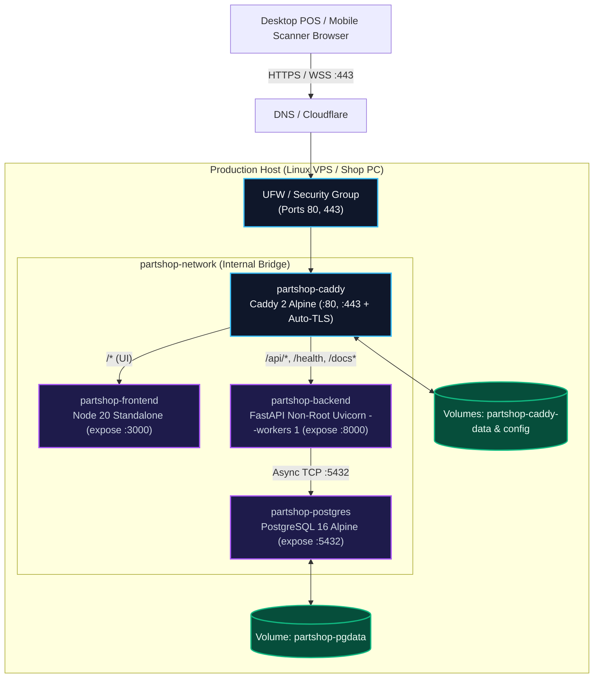
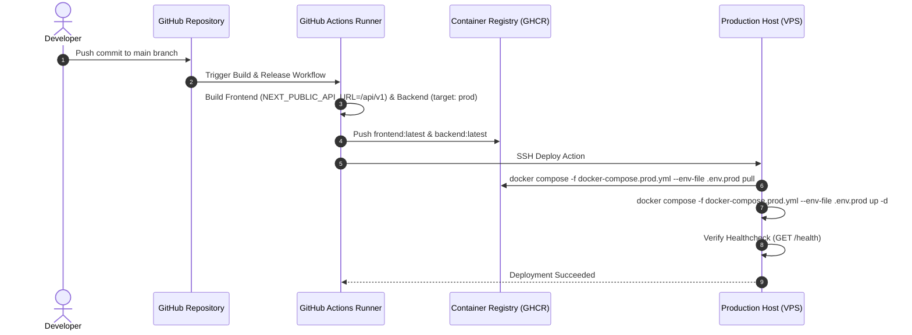

# PartShop — Deployment Architecture & Operations Runbook

> **Document Purpose**: Technical deployment specification, infrastructure topology, CI/CD pipeline design, environment configuration management, and release runbooks.  
> **Source of Truth**: Active codebase (`d:/Programming/PartShop`)  
> **Governance**: Maintained according to rules established in `AGENTS.md`.  
> **Last Updated**: 2026-11-27  

---

## 1. Deployment Philosophy & Architecture Overview

PartShop is designed for reproducible containerized deployments using multi-stage/multi-target Docker builds and segregated Compose configurations (`docker-compose.yml` for local development, `docker-compose.prod.yml` + `Caddyfile` for production). The deployment strategy follows a **Twelve-Factor App** methodology:

1. **Environment Segregation**: Local development uses `docker-compose.yml` (`.env`) with hot-reloading (`--reload`) and exposed ports; production uses `docker-compose.prod.yml` (`.env.prod`) with non-root runners, automatic Alembic migrations on startup, and internal-only backend/PostgreSQL ports.
2. **Same-Origin Edge Reverse Proxy (`Caddyfile`)**: Caddy terminates HTTPS (automatic Let's Encrypt certificates when `SITE_ADDRESS` is a domain) and proxies `/api/*` (including scanner WebSockets), `/health`, and `/docs*` to `backend:8000` while serving UI routes from `frontend:3000`.
3. **Single-Worker WebSocket Consistency**: The FastAPI production container runs with `--workers 1` so all desktop terminals and mobile phone barcode scanners share the same in-memory `ScannerConnectionManager` room registry.
4. **Zero Secrets in Code**: Production credentials (`POSTGRES_PASSWORD`, `BACKEND_SECRET_KEY`) are required at runtime via `.env.prod` (Compose fails fast if omitted).

---

## 2. Infrastructure Deployment Topology

### Production Single-Node VPS / Shop Host Architecture

In production (e.g., Hetzner/DigitalOcean/Oracle VPS or a shop PC behind Cloudflare Tunnel), Caddy terminates SSL/TLS (or accepts HTTP behind Cloudflare Tunnel when `SITE_ADDRESS=:80`) and routes traffic over the internal Docker bridge network:



---

## 3. Environment Configuration Management

PartShop separates environment templates into `.env.example` (local development) and `.env.prod.example` (production). Never commit `.env` or `.env.prod` to version control.

### Production Environment Variables (`.env.prod`)

| Variable Name | Required By | Default in `.env.prod.example` | Production Notes | Description |
| :--- | :--- | :--- | :--- | :--- |
| `SITE_ADDRESS` | Caddy | `:80` | `pos.yourdomain.com` | Domain name for auto-HTTPS, or `:80` behind Cloudflare Tunnel / local testing |
| `HTTP_PORT` | Caddy | `80` | `80` | Host HTTP port |
| `HTTPS_PORT` | Caddy | `443` | `443` | Host HTTPS port |
| `NEXT_PUBLIC_API_URL` | Frontend | `/api/v1` | `/api/v1` | Same-origin API & WebSocket base path (inlined at image build time) |
| `FRONTEND_IMAGE` | Compose | `partshop-frontend:latest` | `ghcr.io/<org>/partshop/frontend:latest` | Optional prebuilt registry image |
| `BACKEND_IMAGE` | Compose | `partshop-backend:latest` | `ghcr.io/<org>/partshop/backend:latest` | Optional prebuilt registry image |
| `POSTGRES_USER` | Postgres / Backend | `partshop_prod_user` | Strong service user | Required database user (Compose fails fast if unset) |
| `POSTGRES_PASSWORD` | Postgres / Backend | Placeholder | Cryptographically random string | Required PostgreSQL secret |
| `POSTGRES_DB` | Postgres / Backend | `partshop_prod_db` | `partshop_prod_db` | Required PostgreSQL catalog |
| `BACKEND_SECRET_KEY` | Backend | Placeholder | `openssl rand -hex 32` | Required JWT signing secret |
| `CORS_ORIGINS` | Backend | `https://pos.yourdomain.com,http://localhost` | Comma-separated origins | Allowed browser origins |
| `CORS_ORIGIN_REGEX` | Backend | Empty | Optional regex | Regex for dynamic origins (used in local LAN dev) |

---

## 4. CI/CD Release Pipeline

For low-RAM VPS instances (e.g., 1 GB RAM), building Docker images in GitHub Actions and pulling them onto the server avoids out-of-memory errors during `npm run build`:



### GitHub Actions Workflow Template (`.github/workflows/deploy.yml` — Planned)

```yaml
name: Deploy PartShop Production

on:
  push:
    branches: [ "main" ]

jobs:
  build-and-deploy:
    runs-on: ubuntu-latest
    steps:
      - name: Checkout Code
        uses: actions/checkout@v4

      - name: Set up Docker Buildx
        uses: docker/setup-buildx-action@v3

      - name: Login to GitHub Container Registry
        uses: docker/login-action@v3
        with:
          registry: ghcr.io
          username: ${{ github.actor }}
          password: ${{ secrets.GITHUB_TOKEN }}

      - name: Build & Push Frontend Image
        uses: docker/build-push-action@v5
        with:
          context: ./frontend
          file: ./frontend/Dockerfile
          build-args: |
            NEXT_PUBLIC_API_URL=/api/v1
          push: true
          tags: |
            ghcr.io/${{ github.repository }}/frontend:latest
            ghcr.io/${{ github.repository }}/frontend:${{ github.sha }}
          cache-from: type=gha
          cache-to: type=gha,mode=max

      - name: Build & Push Backend Image
        uses: docker/build-push-action@v5
        with:
          context: ./backend
          file: ./backend/Dockerfile
          target: prod
          push: true
          tags: |
            ghcr.io/${{ github.repository }}/backend:latest
            ghcr.io/${{ github.repository }}/backend:${{ github.sha }}
          cache-from: type=gha
          cache-to: type=gha,mode=max

      - name: Deploy to Production via SSH
        uses: appleboy/ssh-action@v1.0.3
        with:
          host: ${{ secrets.PROD_SERVER_IP }}
          username: ${{ secrets.PROD_SERVER_USER }}
          key: ${{ secrets.PROD_SSH_PRIVATE_KEY }}
          script: |
            cd /opt/partshop
            docker compose -f docker-compose.prod.yml --env-file .env.prod pull
            docker compose -f docker-compose.prod.yml --env-file .env.prod up -d
            docker image prune -f
```

---

## 5. Production Deployment Operations Runbook

### Prerequisites on Production Host
- Ubuntu 22.04 / 24.04 LTS (or Debian 12)
- Docker Engine >= 26.0 & Docker Compose v2 plugin
- UFW firewall enabled (`ufw allow 22`, `ufw allow 80`, `ufw allow 443`)

### Step 1: Initial Server Provisioning
```bash
sudo git clone https://github.com/your-org/partshop.git /opt/partshop
cd /opt/partshop

# Create production environment file from template
sudo cp .env.prod.example .env.prod
sudo nano .env.prod
# Set SITE_ADDRESS=pos.yourdomain.com, CORS_ORIGINS=https://pos.yourdomain.com,
# strong POSTGRES_PASSWORD, and BACKEND_SECRET_KEY (openssl rand -hex 32)
```

### Step 2: Launch Production Stack
```bash
# Build & launch Caddy + Frontend + Backend (runs alembic upgrade head) + PostgreSQL
docker compose -f docker-compose.prod.yml --env-file .env.prod up -d --build

# Inspect running containers and health checks
docker compose -f docker-compose.prod.yml --env-file .env.prod ps
```

### Step 3: Verify Endpoints & Mobile Scanner HTTPS
- Open `https://pos.yourdomain.com` (or `http://localhost` if testing locally with `SITE_ADDRESS=:80`).
- Verify API health: `curl -I https://pos.yourdomain.com/health`
- Because Caddy serves both the UI and `/api/v1/scanner/ws/*` over HTTPS (`wss://`), smartphone camera scanning (`@zxing/browser`) works out of the box.

*(Note: If running on a shop PC without a public IP, leave `SITE_ADDRESS=:80` and point a free Cloudflare Tunnel at `http://localhost:80`.)*

---

## 6. Update & Rollout Procedures

```bash
cd /opt/partshop
git pull origin main

# Rebuild and recreate updated app containers without touching Postgres or Caddy certs
docker compose -f docker-compose.prod.yml --env-file .env.prod up -d --build frontend backend

# Clean dangling builder layers
docker image prune -f
```

---

## 7. Backup and Disaster Recovery Strategy

### PostgreSQL Automated Backup Script
Create `/opt/partshop/scripts/backup-db.sh`:
```bash
#!/usr/bin/env bash
set -eo pipefail

BACKUP_DIR="/opt/partshop/backups"
TIMESTAMP=$(date +"%Y%m%d_%H%M%S")
FILENAME="partshop_db_${TIMESTAMP}.sql.gz"

mkdir -p "$BACKUP_DIR"

# Execute pg_dump using the configured production credentials
source /opt/partshop/.env.prod
docker compose -f /opt/partshop/docker-compose.prod.yml --env-file /opt/partshop/.env.prod \
  exec -T postgres pg_dump -U "$POSTGRES_USER" "$POSTGRES_DB" | gzip > "$BACKUP_DIR/$FILENAME"

# Delete backups older than 14 days
find "$BACKUP_DIR" -type f -name "*.sql.gz" -mtime +14 -delete

echo "[$(date)] Backup completed: $FILENAME"
```

Configure daily cron job (`crontab -e`):
```cron
0 2 * * * /opt/partshop/scripts/backup-db.sh >> /var/log/partshop-backup.log 2>&1
```

### Database Restoration Procedure
```bash
source /opt/partshop/.env.prod
gunzip < /opt/partshop/backups/partshop_db_YYYYMMDD_HHMMSS.sql.gz | \
  docker compose -f /opt/partshop/docker-compose.prod.yml --env-file /opt/partshop/.env.prod \
  exec -T postgres psql -U "$POSTGRES_USER" -d "$POSTGRES_DB"
```

---

## 8. Rollback Procedure

```bash
git log --oneline -n 5
git checkout tags/v1.0.0
docker compose -f docker-compose.prod.yml --env-file .env.prod up -d --build --no-deps frontend backend
curl -I http://localhost/health
```
