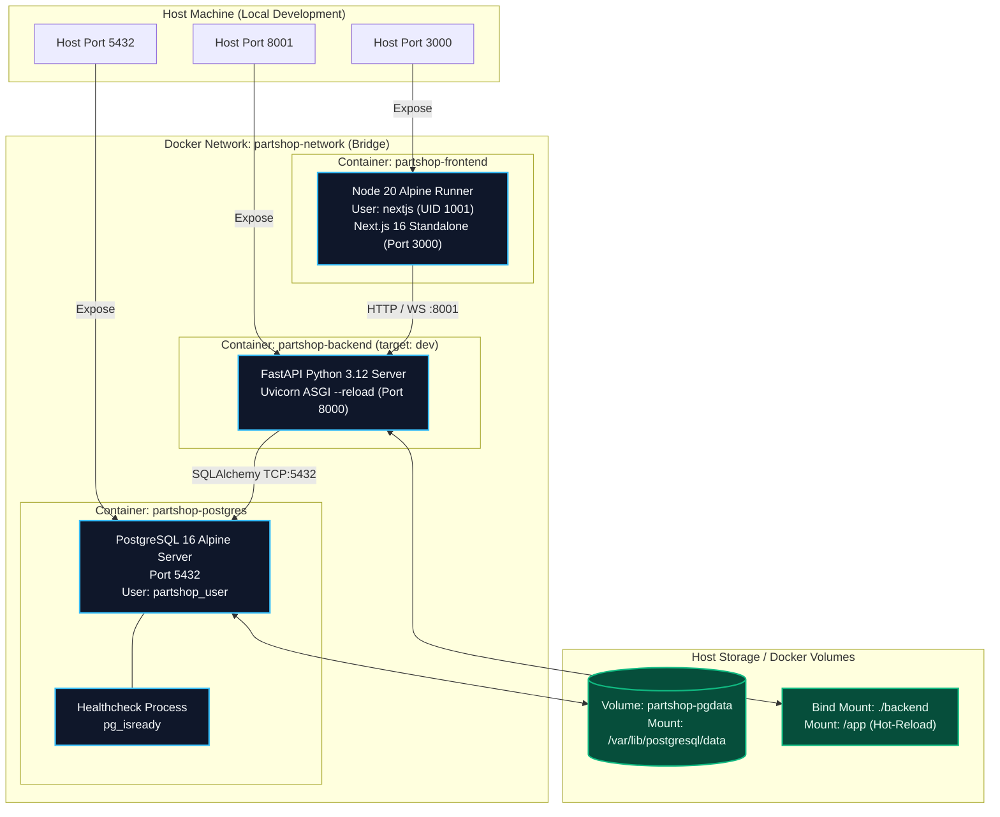
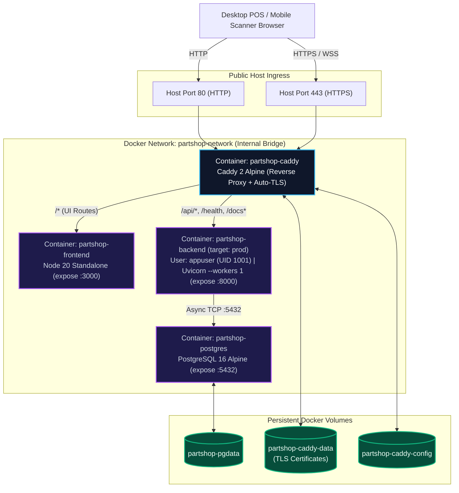
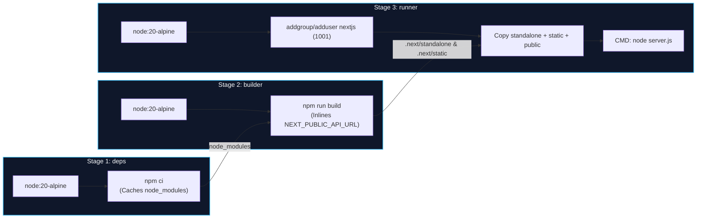
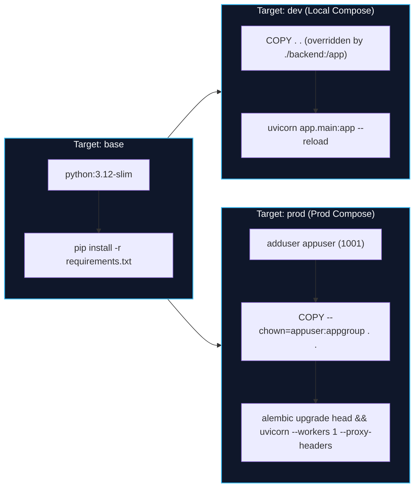

# PartShop — Docker Architecture Specification

> **Document Purpose**: Technical architecture specification for container design, orchestration, volume management, and local vs. production deployment topologies.  
> **Source of Truth**: Active codebase (`d:/Programming/PartShop`)  
> **Governance**: Maintained according to rules established in `AGENTS.md`.  
> **Last Updated**: 2026-11-27  

---

## 1. Architectural Overview & Design Principles

PartShop uses a **segregated environment container topology** managed via Docker Compose:
- **Local Development (`docker-compose.yml`)**: Hot-reloading FastAPI (`--reload` + `./backend:/app` bind mount), direct host port bindings (`3000`, `8001`, `5432`), and LAN Wi-Fi CORS/WebSocket support for local mobile barcode scanning.
- **Production (`docker-compose.prod.yml` + `Caddyfile`)**: Hardened non-root containers, automatic Alembic database migrations on startup, internal-only backend/database ports, and an edge **Caddy 2** reverse proxy with automatic Let's Encrypt HTTPS and WebSocket upgrade proxying.

The architecture is engineered around four primary design tenets:

1. **Ultra-Lightweight Next.js Standalone Packaging**:
   Next.js 16 is compiled with `output: "standalone"` in `frontend/next.config.ts`. Next.js traces all dependency trees and produces a minimal `server.js` runner, reducing final production container image sizes to **~120 MB**.
2. **Multi-Target Backend Image (`dev` vs. `prod`)**:
   `backend/Dockerfile` defines shared `base` dependencies, a `dev` target (`uvicorn --reload` for local development), and a hardened `prod` target running as unprivileged user `appuser:appgroup` (UID/GID 1001) with automatic `alembic upgrade head` and `--workers 1` (preserving in-memory `ScannerConnectionManager` WebSocket session rooms).
3. **Defensive Non-Root Container Security & Network Isolation**:
   In production (`docker-compose.prod.yml`), both `frontend` (`nextjs`, UID 1001) and `backend` (`appuser`, UID 1001) run as non-root users. Neither `backend` nor `postgres` exposes ports on the host network—only `caddy` binds ports `80` and `443`.
4. **Same-Origin Production Routing via Caddy**:
   Caddy routes `/api/*`, `/health`, `/docs*`, and `/openapi.json` to `backend:8000` and all other traffic to `frontend:3000`. Using `NEXT_PUBLIC_API_URL=/api/v1` in production eliminates cross-origin CORS issues and allows the frontend and mobile scanner WebSockets (`wss://.../api/v1/scanner/ws/...`) to share a single HTTPS domain.

---

## 2. Container Architecture & Topology Diagrams

### 2.1 Local Development Topology (`docker-compose.yml`)



### 2.2 Production Topology (`docker-compose.prod.yml`)



---

## 3. Multi-Stage Build Strategies

### 3.1 Frontend Multi-Stage Build (`frontend/Dockerfile`)



### 3.2 Backend Multi-Target Build (`backend/Dockerfile`)



*(Note: `backend/.dockerignore` excludes `.venv/`, `__pycache__/`, `.env*`, and `.git/` from the Docker build context.)*

---

## 4. Container Inventory & Specifications

### 4.1 Service: `frontend`
- **Build Context**: `./frontend` (`frontend/Dockerfile`)
- **Build Argument**: `NEXT_PUBLIC_API_URL`
  - Local (`docker-compose.yml`): `http://localhost:8001/api/v1`
  - Production (`docker-compose.prod.yml`): `/api/v1` (same-origin Caddy reverse proxy)
- **Port**: `3000` (mapped to `${FRONTEND_PORT:-3000}` locally; internal `expose` only in production)
- **User**: `nextjs` (UID 1001)
- **Healthcheck**: `node -e "fetch('http://127.0.0.1:3000')..."`

### 4.2 Service: `backend`
- **Build Context**: `./backend` (`backend/Dockerfile`)
- **Targets**:
  - Local (`docker-compose.yml`): `target: dev`, port `${BACKEND_PORT:-8001}:8000`, bind mount `./backend:/app`, `ENVIRONMENT=development`
  - Production (`docker-compose.prod.yml`): `target: prod`, internal `expose: ["8000"]`, no bind mounts, non-root `appuser` (UID 1001), `ENVIRONMENT=production`, `--workers 1`, `--proxy-headers --forwarded-allow-ips='*'`
- **CORS Configuration**: Driven by `CORS_ORIGINS` (comma-separated) and optional `CORS_ORIGIN_REGEX` (local compose allows private LAN `192.168.*`, `10.*`, `172.16-31.*` on port `3000`).
- **Healthcheck**: `python -c "import urllib.request; urllib.request.urlopen('http://127.0.0.1:8000/health')"`

### 4.3 Service: `postgres`
- **Image**: `postgres:16-alpine`
- **Port**: `5432` (mapped to `${POSTGRES_PORT:-5432}` locally; internal `expose` only in production)
- **Volume**: `pgdata:/var/lib/postgresql/data`
- **Healthcheck**: `pg_isready`

### 4.4 Service: `caddy` *(Production Only)*
- **Image**: `caddy:2-alpine`
- **Ports**: `${HTTP_PORT:-80}:80`, `${HTTPS_PORT:-443}:443`
- **Config Mount**: `./Caddyfile:/etc/caddy/Caddyfile:ro`
- **Environment**: `SITE_ADDRESS` (defaults to `:80` for local/tunnel testing; set to `pos.yourdomain.com` for automatic Let's Encrypt HTTPS)
- **Volumes**: `caddy_data:/data`, `caddy_config:/config`

---

## 5. Storage & Volume Management

| Volume Name | Environment | Container Mount Target | Purpose |
| :--- | :--- | :--- | :--- |
| `partshop-pgdata` | Local & Prod | `/var/lib/postgresql/data` | PostgreSQL tables, WAL logs, indexes |
| `partshop-caddy-data` | Prod Only | `/data` | Let's Encrypt TLS certificates and ACME state |
| `partshop-caddy-config` | Prod Only | `/config` | Caddy persisted runtime configuration |

---

## 6. Docker Workflows & Operational Runbook

### 6.1 Local Development (`docker-compose.yml`)
```powershell
# 1. Initialize local environment config
Copy-Item .env.example .env

# 2. Build and start Frontend, Backend (hot-reload), and PostgreSQL
docker compose up -d --build

# 3. Check container health and logs
docker compose ps
docker compose logs -f
```
*(Rebuild frontend after React/Next.js edits via `docker compose up -d --build frontend`; rebuild backend after `requirements.txt` updates via `docker compose up -d --build backend`.)*

### 6.2 Production Deployment (`docker-compose.prod.yml`)
```bash
# 1. Initialize production environment config with strong secrets
cp .env.prod.example .env.prod
nano .env.prod

# 2. Build and launch hardened production stack (Caddy + Frontend + Backend + Postgres)
docker compose -f docker-compose.prod.yml --env-file .env.prod up -d --build

# 3. Or pull pre-built registry images (recommended on 1 GB RAM VPS)
docker compose -f docker-compose.prod.yml --env-file .env.prod pull
docker compose -f docker-compose.prod.yml --env-file .env.prod up -d
```

### 6.3 Clean Teardown
```powershell
# Stop containers keeping database & TLS volumes intact
docker compose down

# Production stop keeping volumes intact
docker compose -f docker-compose.prod.yml --env-file .env.prod down

# Destructive reset (deletes database volume!)
docker compose down -v
```
