# PartShop — Frontend Integration Milestones & UI/UX Roadmap

> **Document Purpose**: Living progress tracker, step-by-step curriculum, code change ledger, and architectural guide for integrating the Next.js 16 Liquid Glass frontend with the live FastAPI backend.  
> **Source of Truth**: Active Codebase (`d:/Programming/PartShop/frontend`)  
> **Governance**: Maintained according to rules established in `AGENTS.md`.  
> **Last Updated**: 2026-11-26  

---

## 1. Learning Philosophy & Collaboration Model

This frontend integration follows a **Mentorship & Learning-First Engineering Model**:
- **You write the code**: You inspect each component and write or update the integration logic yourself to build muscle memory and deep practical understanding.
- **Guidance on "Where" & "Why"**: Every step specifies the exact file location, clean TypeScript code, and plain-English explanations of *why* enterprise web apps decouple views from data transport.
- **Living Code Ledger**: Every file created, adapter built, and view connected is recorded right here in this document as our permanent reference manual.
- **Zero-Mock Goal**: The objective of this roadmap is to systematically replace every mock data handler (`initialProducts`, `salesTrend`, `alert()`) with real, authenticated PostgreSQL database interactions.

```mermaid
flowchart LR
    F0["Milestone F0<br/>Modular API Client<br/>(Done)"] --> F1["Milestone F1<br/>Auth & Session<br/>(Done)"]
    F1 --> F2["Milestone F2<br/>Live POS Billing<br/>(Done)"]
    F2 --> F3["Milestone F3<br/>Inventory & Excel<br/>(Done)"]
    F3 --> F4["Milestone F4<br/>Analytics & Reports<br/>(Done)"]
    F4 --> F5["Milestone F5<br/>Zero-Mock Verification<br/>(Done)"]
    F5 --> F6["Milestone F6<br/>Brands & Mechanics<br/>(Done)"]
    F6 --> F7["Milestone F7<br/>Token Search Engine<br/>(Done)"]
    F7 --> F8["Milestone F8<br/>Suppliers & Purchase Disc<br/>(Done)"]
    F8 --> F9["Milestone F9<br/>Dedicated Search Tab<br/>(Done)"]

    classDef done fill:#064e3b,stroke:#10b981,stroke-width:2px,color:#ecfdf5;
    classDef current fill:#1e1b4b,stroke:#a855f7,stroke-width:2px,color:#cbd5e1;
    classDef pending fill:#0f172a,stroke:#64748b,stroke-width:1px,color:#94a3b8;

    class F0,F1,F2,F3,F4,F5,F6,F7,F8,F9 done;
```



---

## 2. Master Frontend Milestone Status Tracker

| Milestone | Title | Key Objective | Status | Completed Date |
| :--- | :--- | :--- | :---: | :---: |
| **Milestone F0** | **Modular API Client Layer** | Build `src/api/` (`client.ts`, domain modules, adapters, barrel export). | `Completed` | 2026-11-25 |
| **Milestone F1** | **Cashier Auth & Session Token** | Dedicated Liquid Glass LoginView, JWT `localStorage` management, profile lookup. | `Completed` | 2026-11-25 |
| **Milestone F2** | **Live POS Counter Billing** | Wire `BillingView.tsx`: live barcode gun lookup, `billingApi.checkout()`, real invoice receipt, and stock decrement. | `Completed` | 2026-11-25 |
| **Milestone F3** | **Inventory & Excel Bulk Import** | Wire `InventoryView.tsx`: hidden `.xlsx` file upload, error modal with row feedback, live catalog reload. | `Completed` | 2026-11-25 |
| **Milestone F4** | **Real-Time Analytics & Dashboard** | Wire `DashboardView.tsx` & `ReportsView.tsx`: live revenue KPIs, 18% GST tax liability, top-selling charts, and low-stock warning cards. | `Completed` | 2026-11-25 |
| **Milestone F5** | **Zero-Mock Full-Stack Verification** | Eliminate all mock data imports; verify end-to-end full stack in Docker Compose. | `Completed` | 2026-11-25 |
| **Milestone F6** | **Brands Master & Mechanic Commission Matrix** | Brands CRUD modal, Edit Part modal with live stock adjustment, bike model search autocomplete on POS counter, and date-wise mechanic parts/commission ledger. | `Completed` | 2026-11-26 |
| **Milestone F7** | **Tokenized Automotive Search Engine** | Multi-token search with automotive stem/abbreviation expansions (`filter`/`filt`, `brake`/`brk`, `cushion`/`shock`) across all catalog attributes. | `Completed` | 2026-11-26 |
| **Milestone F8** | **Wholesale Supplier Management & Purchase Discounts** | Live supplier directory, "+ Add / Edit Supplier" modals, "View Supplied Items" parts drawer, Excel workbook import under supplier with purchase discount mapping, and inventory supplier filtering. | `Completed` | 2026-11-26 |
| **Milestone F9** | **Dedicated Quick Spares Search Tab** | Dedicated `SearchView.tsx` with hero search input, quick preset chips, and detailed part cards (Item Name, Price, Supported Model, Supplier Details, Quantity, Selling Price, Rack No). | `Completed` | 2026-11-26 |

---

## 3. Detailed Milestone Breakdowns & Code Ledger

---

### Milestone F0: Modular API Client Layer
- **Status**: `Completed` (2026-11-25)
- **Objective**: Establish a scalable, domain-driven API client architecture separating HTTP network transport from UI components.

#### 1. File Created: `frontend/src/api/client.ts`
```typescript
/**
 * Shared HTTP Client for PartShop API.
 * Handles base URL configuration, JWT bearer tokens, and standardized error normalization.
 */

const API_BASE_URL =
  process.env.NEXT_PUBLIC_API_URL || "http://localhost:8001/api/v1";

export interface RequestOptions extends RequestInit {
  params?: Record<string, string | number | boolean | undefined>;
}

export async function apiClient<T>(
  endpoint: string,
  options: RequestOptions = {}
): Promise<T> {
  const { params, headers, ...customConfig } = options;

  let url = `${API_BASE_URL}${endpoint.startsWith("/") ? endpoint : `/${endpoint}`}`;
  if (params) {
    const searchParams = new URLSearchParams();
    Object.entries(params).forEach(([key, value]) => {
      if (value !== undefined && value !== null && value !== "") {
        searchParams.append(key, String(value));
      }
    });
    const queryString = searchParams.toString();
    if (queryString) {
      url += (url.includes("?") ? "&" : "?") + queryString;
    }
  }

  const token =
    typeof window !== "undefined" ? localStorage.getItem("partshop_token") : null;

  const defaultHeaders: HeadersInit = {
    "Content-Type": "application/json",
    ...(token ? { Authorization: `Bearer ${token}` } : {}),
    ...headers,
  };

  const response = await fetch(url, {
    ...customConfig,
    headers: defaultHeaders,
  });

  if (!response.ok) {
    const errorBody = await response.json().catch(() => ({}));
    const message =
      errorBody.detail ||
      errorBody.message ||
      `HTTP Error ${response.status}: ${response.statusText}`;
    throw new Error(message);
  }

  if (response.status === 204) {
    return {} as T;
  }

  return response.json();
}
```
> **Why**: Centralizes HTTP network transport, base URL resolution, query string encoding, and JWT authentication in a single function.

---

#### 2. Domain Modules Created in `frontend/src/api/modules/`

- **`parts.api.ts`**:
  - `partsApi.getAll(search, brand)`: Paginated catalog query.
  - `partsApi.getByBarcode(barcode)`: Instant scanner query.
  - `partsApi.create(part)`: Inventory item creation.
  - `mapBackendPartToFrontend`: Adapter transforming snake_case backend models to camelCase frontend models and automatically determining `StockStatus`.
- **`billing.api.ts`**:
  - `billingApi.checkout(payload)`: Atomic checkout transaction with row-level locks and GST.
  - `billingApi.getInvoiceById(id)`: Thermal receipt fetching.
- **`imports.api.ts`**:
  - `importsApi.uploadCatalogExcel(file)`: Multipart `FormData` upload for `.xlsx` catalogs with row-by-row error reporting.
- **`reports.api.ts`**:
  - `reportsApi.getDailySales(date)`: Nightly sales settlement and payment breakdown.
  - `reportsApi.getTopSelling(limit)`: High-velocity parts ranking.
  - `reportsApi.getLowStock()`: Urgent low-stock inventory alerts.

---

#### 3. File Created: `frontend/src/api/index.ts`
```typescript
export { apiClient } from "./client";
export type { RequestOptions } from "./client";

export { partsApi, mapBackendPartToFrontend } from "./modules/parts.api";
export type { BackendSparePart, PaginatedPartsResponse } from "./modules/parts.api";

export { billingApi } from "./modules/billing.api";
export type { CheckoutPayload, InvoiceResponse, CartItemPayload, InvoiceItemResponse } from "./modules/billing.api";

export { importsApi } from "./modules/imports.api";
export type { ImportSummaryResponse, RowErrorDetail } from "./modules/imports.api";

export { reportsApi } from "./modules/reports.api";
export type { DailySalesSummary, TopSellingPart, LowStockItem, PaymentBreakdown } from "./modules/reports.api";
```

---

#### 4. File Updated: `frontend/src/app/page.tsx`
Connected root controller to load live inventory from `partsApi.getAll()` with fallback to mock data on initial load.

---

### Milestone F1: Cashier Auth & Session Token Management
- **Status**: `Completed` (2026-11-25)
- **Objective**: Establish authenticated session persistence in the browser so that cashier checkouts and manager uploads are authorized by FastAPI.

#### 1. File Created: `frontend/src/api/modules/auth.api.ts`
```typescript
const API_BASE_URL =
  process.env.NEXT_PUBLIC_API_URL || "http://localhost:8001/api/v1";

export interface UserProfile {
  id: number;
  username: string;
  email: string;
  full_name: string;
  role: "ADMIN" | "STORE_MANAGER" | "COUNTER_STAFF";
  is_active: boolean;
}

export interface LoginResponse {
  access_token: string;
  token_type: string;
}

export const authApi = {
  async login(username = "cashier1", password = "Password123!"): Promise<LoginResponse> {
    const formData = new URLSearchParams();
    formData.append("username", username);
    formData.append("password", password);

    const res = await fetch(`${API_BASE_URL}/auth/login`, {
      method: "POST",
      headers: { "Content-Type": "application/x-www-form-urlencoded" },
      body: formData.toString(),
    });

    if (!res.ok) {
      const err = await res.json().catch(() => ({}));
      throw new Error(err.detail || "Authentication failed");
    }

    const data: LoginResponse = await res.json();
    if (typeof window !== "undefined") {
      localStorage.setItem("partshop_token", data.access_token);
    }
    return data;
  },

  async getMe(): Promise<UserProfile> {
    const token =
      typeof window !== "undefined" ? localStorage.getItem("partshop_token") : null;

    if (!token) throw new Error("No token found");

    const res = await fetch(`${API_BASE_URL}/auth/me`, {
      headers: {
        "Content-Type": "application/json",
        Authorization: `Bearer ${token}`,
      },
    });

    if (!res.ok) {
      if (typeof window !== "undefined") localStorage.removeItem("partshop_token");
      throw new Error("Failed to retrieve user profile");
    }

    return res.json();
  },

  logout() {
    if (typeof window !== "undefined") {
      localStorage.removeItem("partshop_token");
    }
  },

  isAuthenticated(): boolean {
    if (typeof window !== "undefined") {
      return !!localStorage.getItem("partshop_token");
    }
    return false;
  },
};
```
> **Why**: Adheres strictly to FastAPI's `OAuth2PasswordRequestForm` standard using `application/x-www-form-urlencoded` payloads and persists the JWT in `localStorage`.

---

#### 2. File Created: `frontend/src/components/views/LoginView.tsx`
Implements a dedicated Liquid Glass Login screen featuring:
- Floating glass card with live API status badge (`API: 8001`).
- Username and password inputs using custom `GlassInput`.
- Quick-fill buttons for instant demo sign-in (`cashier1` / `admin`).
- Real authentication submission against `authApi.login()`.

---

#### 3. File Updated: `frontend/src/app/page.tsx`
Connected root controller authentication gate:
- Verifies session token on initial mount (`authApi.getMe()`).
- Shows `LoginView` if unauthenticated.
- Renders full POS Terminal canvas only when authenticated cashier profile is loaded.
- Handles logout cleanly via `authApi.logout()`.

---

### Milestone F2: Live POS Counter Billing & Invoices
- **Status**: `Completed` (2026-11-25)
- **Objective**: Connect `BillingView.tsx` to `billingApi.checkout()` and `partsApi.getByBarcode()` so checkouts decrement physical PostgreSQL stock and render official thermal receipts.

#### 1. File Updated: `frontend/src/components/views/BillingView.tsx`
- **Live Barcode Gun Scanning**: Checks local memory first; if not found, immediately invokes `partsApi.getByBarcode(query)` to query PostgreSQL (< 5ms).
- **Atomic Checkout Execution**: Packages cart rows into `CheckoutPayload` and triggers `billingApi.checkout()`.
- **Live Settlement UI**: Renders the generated invoice identifier (`INV-YYYYMMDD-...`), calculated 18% GST, and grand total.
- **Stock Synchronization**: Automatically clears the shopping cart and calls `onCheckoutSuccess()` to refresh inventory catalog stock across the application.

---

### Milestone F3: Catalog Inventory & Excel Bulk Import
- **Status**: `Completed` (2026-11-25)
- **Objective**: Connect `InventoryView.tsx` to `importsApi.uploadCatalogExcel(file)` with a hidden file input, upload progress state, and detailed row error modal.

#### 1. File Updated: `frontend/src/components/views/InventoryView.tsx`
- **Real Excel Upload**: Integrated hidden `<input type="file" accept=".xlsx,.xlsm" />` triggered by the "Import Excel" button.
- **Multipart Streaming**: Dispatches file to `importsApi.uploadCatalogExcel(file)` with visual loading spinners.
- **Detailed Audit Modal**: Displays total processed rows, imported count, skipped count, and exact row-number duplicate/format error logs.
- **Manual "+ Add Part" Modal**: Implemented interactive form modal submitting new items directly to `partsApi.create()`.

---

### Milestone F4: Real-Time Business Analytics & Dashboard
- **Status**: `Completed` (2026-11-25)
- **Objective**: Connect `DashboardView.tsx` and `ReportsView.tsx` to `reportsApi.getDailySales()`, `reportsApi.getTopSelling()`, and `reportsApi.getLowStock()`.

#### 1. File Updated: `frontend/src/components/views/DashboardView.tsx`
- **Live Financial KPIs**: Real-time "Today's Sales" and "GST Collected (18%)" fed directly by `reportsApi.getDailySales()`.
- **Catalog Valuation**: Dynamic computation of Total Inventory Value and stock units on shelf from live catalog data.
- **Top Fast-Moving Spares**: Table populated with live item sales velocity and revenue from `reportsApi.getTopSelling()`.

#### 2. File Updated: `frontend/src/components/views/ReportsView.tsx`
- **Live Reconciliation Modal**: Replaced static alerts with interactive modal inspecting real sales totals, payment method settlement breakdown (Cash, Card, UPI, Credit), and discounts.
- **Live Low-Stock Modal**: Real-time table audit displaying parts at or below minimum threshold buffer.

### Milestone F7: Tokenized Automotive Search Engine
- **Status**: `Completed` (2026-11-26)
- **Objective**: Implement multi-token, abbreviation-tolerant search matching across all catalog attributes (name, OEM part number, bike models, brand, rack, and barcode) with automotive domain stem expansions.

#### 1. File Created: `frontend/src/utils/search.ts`
- **Automotive Synonym Dictionary**: Comprehensive mapping of standard workshop search queries to catalog stems (`filter` ↔ `filt`, `brake` ↔ `brk`/`pad`/`shoe`, `shock`/`cushion` ↔ `cush`/`damper`, `clutch` ↔ `clt`, `assembly` ↔ `assy`, `indicator` ↔ `ind`/`winker`, etc.).
- **Multi-Token Match Engine**: `matchSearchTokens(targetText, query)` breaks queries into tokens, evaluating each token independently across the entire concatenated record with synonym support.

#### 2. Files Updated
- `frontend/src/components/views/InventoryView.tsx`: Integrated `matchSearchTokens` over catalog items for zero-latency (< 5ms) filtering as cashier types.
- `frontend/src/components/views/BillingView.tsx`: Integrated `matchSearchTokens` in autocomplete product picker and Enter-key instant line-item addition.
- `frontend/src/api/modules/parts.api.ts`: Increased catalog fetch limit to 500 items.

---

### Milestone F6: Brands Master & Mechanic Commission Matrix
- **Status**: `Completed` (2026-11-25)
- **Objective**: Verify complete system operation in Docker Compose (`partshop-frontend` + `partshop-backend` + `partshop-postgres`).

#### Verification Summary
- **TypeScript Static Analysis**: `Finished TypeScript in 12.2s ...` with **0 errors**.
- **Page Pre-rendering**: `Generating static pages (4/4)` generated all routes successfully.
- **Docker Compose Topology**:
  - `partshop-postgres`: Port 5432 (PostgreSQL 16 Alpine with persistent volume `pgdata`)
  - `partshop-backend`: Port 8001 (FastAPI Python 3.12 REST API with live hot-reloading)
  - `partshop-frontend`: Port 3000 (Next.js 16 App Router with Liquid Glass UI)

---

### Milestone F8: Wholesale Supplier Management & Purchase Discounts
- **Status**: `Completed` (2026-11-26)
- **Objective**: Implement comprehensive wholesale supplier partner directory, supplier items drawer, Excel workbook catalog import with automatic supplier and purchase discount inheritance, and inventory supplier filtering.

#### 1. File Created: `frontend/src/api/modules/suppliers.api.ts`
- Provides `suppliersApi.getAll(activeOnly)`, `suppliersApi.getById(id)`, `suppliersApi.create(supplierData)`, `suppliersApi.update(id, supplierData)`, `suppliersApi.delete(id)`, and `suppliersApi.getSupplierParts(supplierId)`.
- Includes `mapBackendSupplierToFrontend` adapter ensuring clean camelCase contracts (`defaultDiscountPercentage`, `totalPartsCount`).

#### 2. File Updated: `frontend/src/components/views/SuppliersView.tsx`
- **Live Wholesale Directory**: Real-time rendering of all distributor partners with live mapped parts count (`totalPartsCount`) and default purchase discount badges.
- **"+ Add Supplier" & "Edit Supplier" Modals**: Allows counter staff and store managers to register new agencies, update GSTIN compliance numbers, phone, address, and default purchase discount rates.
- **"View Supplied Items" Parts Drawer**: Interactive modal showing all parts provided by a selected supplier, including part number, OEM description, bike model compatibility, purchase discount %, purchase cost, MRP, and stock level.
- **"Upload Supplier Catalog / Bill" Action**: Quick modal to upload Excel workbooks directly tagged to the selected distributor.

#### 3. File Updated: `frontend/src/components/views/InventoryView.tsx`
- **Supplier & Purchase Discount Column**: Added to inventory table displaying distributor name and purchase discount percentage (e.g. `14.5%`).
- **Live Supplier Filter**: Dropdown filter enabling staff to instantly isolate parts sourced from specific suppliers (e.g. "Kalyani Honda Spares", "Om Sai Auto Spares").
- **Manual Part Modals with Supplier**: Add Part and Edit Part modals enhanced with Supplier selection dropdown and purchase discount rate input.
- **Excel Upload with Supplier Selection**: Upload modal allows picking the source distributor and setting/overriding the wholesale purchase discount percentage applied across the uploaded file.

#### 4. Verification & Container Health
- **Next.js Compilation**: Recompiled successfully in Docker Compose runner (`docker compose up -d --build frontend`) with 0 TypeScript and Webpack errors.
- **Zero-Mock Verification**: Live end-to-end communication with FastAPI endpoints (`/api/v1/suppliers`, `/api/v1/suppliers/{id}/parts`, `/api/v1/imports/parts-excel`).

---

### Milestone F9: Dedicated Quick Spares Search Tab & Card-Based Lookup
- **Status**: `Completed` (2026-11-26)
- **Objective**: Create a focused, dedicated search terminal tab where counter staff can find any motorcycle spare part in under 1 second via a minimalist hero search bar, displaying matches in comprehensive Liquid Glass cards.

#### 1. File Created: `frontend/src/components/views/SearchView.tsx`
- **Minimalist Hero Search Interface**: Prominent search bar as the page's primary focal point with autofocus, clear button (`X`), and keyboard shortcut hints.
- **Popular Preset Chips**: Quick search shortcut buttons for frequent counter requests ("Bajaj Pulsar Air filter", "Activa Brake Pad", "Splendor Clutch Plate", "Chain Sprocket", "Bosch Spark Plug").
- **Card-Based Anatomy**: Every matched item renders as a full `GlassCard` featuring:
  - **Item Name**: Full description with brand tag and stock status badge (`GlassBadge`).
  - **Price & Selling Price**: Prominent counter retail price (`MRP`) and purchase cost.
  - **Supported Models**: Compatible motorcycle fitment with bike icon.
  - **Supplier Details**: Wholesale supplier name and purchase discount percentage badge (e.g. `14.5% Disc`).
  - **Quantity**: Units on shelf with color-coded stock alerts.
  - **Rack No**: Physical shop bin / shelf locator (e.g. `Rack: B-04`).
  - **One-Click Actions**: Quick copy button for part numbers and "Bill Item" action button navigating directly to counter POS checkout.

#### 2. Files Updated
- `frontend/src/types/index.ts`: Added `"Search"` to `NavigationSection`.
- `frontend/src/components/layout/GlassSidebar.tsx`: Added dedicated `Search` tab with `Search` icon and `"Fast"` badge in primary navigation dock.
- `frontend/src/app/page.tsx`: Integrated `SearchView` component with catalog state and navigation callbacks.

#### 3. Verification & Container Health
- **Next.js Compilation**: `Generating static pages (4/4)` built cleanly in Docker with 0 errors.
- **HTTP Status Check**: Verified `http://localhost:3000` responds with status `200`.
