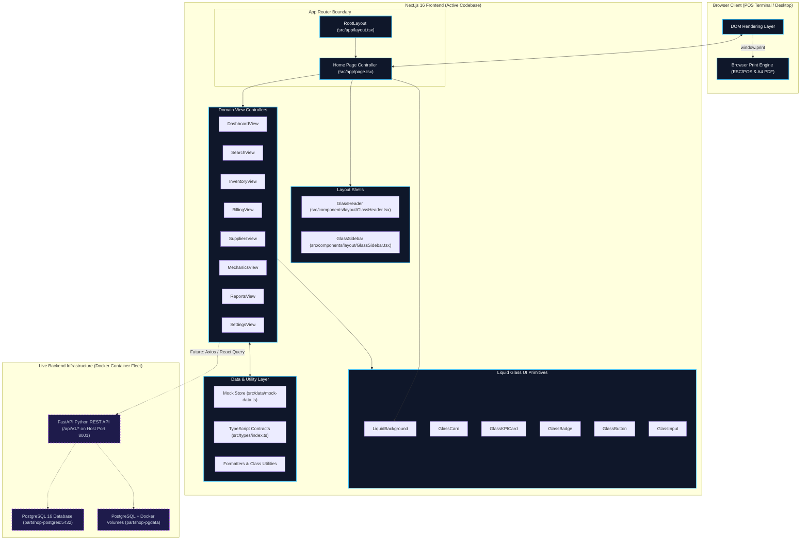
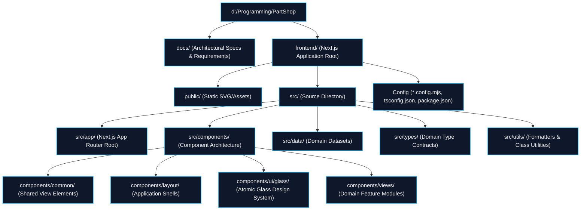
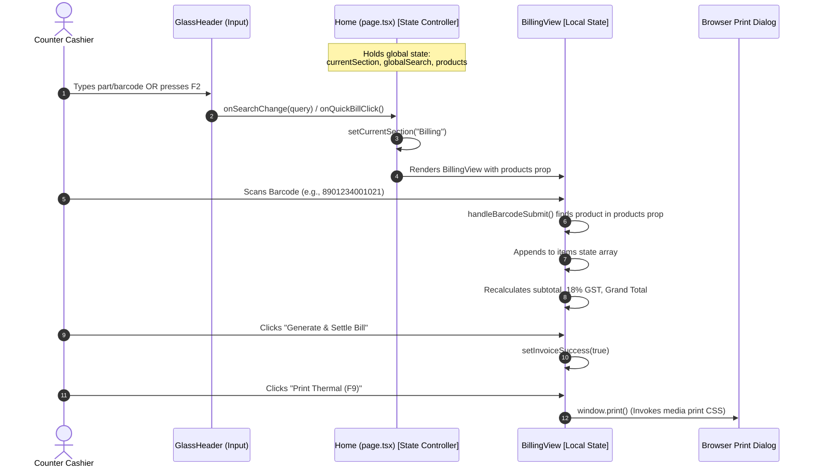
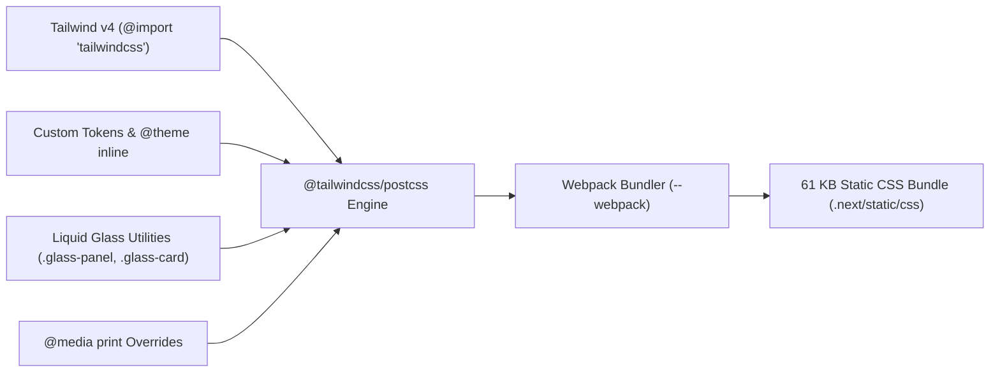
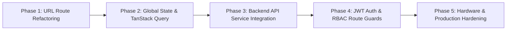

# PartShop — Frontend System Architecture Specification

> **Document Type**: Frontend System & Software Architecture Document  
> **Target System**: PartShop Motorcycle Spare Parts ERP & POS  
> **Source of Truth**: Current Codebase Implementation (`d:\Programming\PartShop`)  
> **Architectural Level**: Principal Software Architect Assessment  
> **Status**: Production Reference Document  

---

## 1. Executive Summary & Architectural Scope

PartShop is a specialized enterprise resource planning (ERP) and point-of-sale (POS) web application designed for motorcycle spare parts retailers and service workshops. The frontend is built on **Next.js 16 (App Router)** and **React 19**, implementing a custom **Liquid Glass (Fluid Glassmorphic Dark)** user interface system.

This document represents the single source of truth for the frontend architecture. It reflects the **actual implemented codebase**, explicitly delineating what currently exists from what is specified as planned in [requirements.md](file:///d:/Programming/PartShop/docs/requirements.md).

```
Current Reality:
├── Frontend: Complete Next.js 16 Client-Side SPA Orchestration + Mock Data Engine
└── Backend / Database: Planned / Not Yet Implemented (No API routes or FastAPI service in workspace)
```

---

## 2. Technology Stack (Actual vs. Planned)

The following matrix documents the exact versions, libraries, and integration mechanisms currently in the workspace versus planned specifications:

| Layer / Concern | Current Implementation | Specified in `requirements.md` | Status / Gap Analysis |
| :--- | :--- | :--- | :--- |
| **Framework** | Next.js 16.4.6 (App Router) | Next.js (React) | **Implemented** |
| **Runtime / Library** | React 19.3.0 + React DOM 19.3.0 | React | **Implemented** |
| **Language** | TypeScript 5.9.3 (`strict: true`) | TypeScript | **Implemented** |
| **Styling Engine** | Tailwind CSS 4.3.3 (`@import "tailwindcss";`) | Tailwind CSS | **Implemented** |
| **CSS Compiler** | PostCSS 8.5.33 + `@tailwindcss/postcss` 4.3.5 | Not specified | **Implemented** (fixes Turbopack Windows bug) |
| **Bundler Mode** | Next.js Webpack engine (`--webpack`) | Turbopack / Default | **Implemented** (ensures Windows IPC stability) |
| **Icons** | `lucide-react` 1.76.0 | Not specified | **Implemented** |
| **Charts & Analytics**| `recharts` 3.11.0 | Not specified | **Implemented** |
| **State Management** | React Local State (`useState`, `useEffect`) | TanStack / React Query | **Architectural Choice**: Native state + Modular API layer |
| **API Client** | Modular Domain API Client (`src/api/`) | Axios | **Implemented**: Native `fetch` with modular domain services |
| **Component Primitives**| Custom Atomic Liquid Glass Primitives | ShadCN UI Components | **Substituted**: Tailored in-house Liquid Glass suite |
| **Backend REST API** | FastAPI Python REST API (Port 8001) | FastAPI + Python 3.12 | **Implemented** |
| **Database** | PostgreSQL 16 (Docker) + SQLAlchemy 2.0 Async + Alembic | PostgreSQL + SQLAlchemy + Alembic | **Implemented** |
| **Authentication** | JWT Token + Role-Based Guards (`ADMIN`, `STAFF`) | JWT + RBAC | **Implemented** |

---

## 3. High-Level System Architecture

The following diagram illustrates the relationship between the active client application, its internal modular layers, and the external backend infrastructure planned in `requirements.md`:



---

## 4. Project Structure & Folder Responsibilities

The codebase follows a modular feature-view architecture. Below is the structural map and file-level responsibility ledger:



### Directory Responsibility Ledger

| Path | Responsibility | State / Execution Context |
| :--- | :--- | :--- |
| `docs/requirements.md` | Original product requirements and target architecture specification | Static Reference |
| `docs/ui-design.md` | Liquid glass visual guidelines, color scales, optical layers, and print CSS rules | Static Reference |
| `docs/ui-architecture.md` | Formal frontend technical architecture and implementation audit | Single Source of Truth |
| `frontend/package.json` | Project dependencies, npm lifecycle scripts (`dev`, `build` with `--webpack`) | Build Configuration |
| `frontend/postcss.config.mjs`| PostCSS configuration routing Tailwind CSS v4 processing | Build Configuration |
| `frontend/next.config.ts` | Next.js core configuration (`cacheComponents`, `partialPrefetching`) | Next.js Server Config |
| `frontend/src/app/layout.tsx` | Base HTML skeleton, font injection (`Geist`, `Geist_Mono`), global CSS inclusion | Server Component (SSR) |
| `frontend/src/app/globals.css`| Tailwind v4 imports, `@theme inline`, liquid glass primitives, print stylesheets | Global CSS Asset |
| `frontend/src/app/page.tsx` | Single-page orchestrator; manages active view state, search query, mobile sidebar | Client Component (`"use client"`) |
| `frontend/src/types/index.ts` | TypeScript domain contracts matching planned PostgreSQL tables | Type System |
| `frontend/src/data/mock-data.ts` | Realistic motorcycle spare parts, suppliers, mechanics, and sales analytics | In-Memory Mock Store |
| `frontend/src/utils/cn.ts` | Classnames concatenator utility | Pure Function |
| `frontend/src/utils/formatters.ts` | Currency (`₹` in `en-IN` format) and locale date formatters | Pure Functions |
| `frontend/src/components/common/` | Shared page-level headings and title badges | UI Components |
| `frontend/src/components/layout/` | Structural shells: `GlassSidebar` (navigation dock) and `GlassHeader` (topbar) | Layout Components |
| `frontend/src/components/ui/glass/` | Atomic liquid glass primitives (`LiquidBackground`, `GlassCard`, `GlassInput`, etc.)| Presentation Components |
| `frontend/src/components/views/` | Eight discrete domain modules (`Dashboard`, `Search`, `Inventory`, `Billing`, etc.) | Feature Module Views |

---

## 5. App Router, Page Hierarchy & Routing Strategy

### Current Routing Strategy: Single-Page Dynamic View Switching
The current frontend operates as an **App Router SPA (Single Page Application)**. While Next.js App Router typically encourages folder-based URL segments (`/billing`, `/inventory`), the application currently utilizes a centralized client-side view switch inside `src/app/page.tsx`:

- **Active Route**: `/` (Root route)
- **Active Controller**: `Home` in `src/app/page.tsx`
- **Navigation Model**: Internal React state (`currentSection: NavigationSection`) drives the rendered view:
  ```typescript
  export type NavigationSection =
    | "Dashboard"
    | "Search"
    | "Inventory"
    | "Billing"
    | "Suppliers"
    | "Mechanics"
    | "Reports"
    | "Settings";
  ```

### Why This Was Implemented
For high-speed counter POS terminals, full page transitions that cause network re-fetches or unmounting of background canvases can cause perceptual latency. Tab-switching keeps the ambient liquid glass canvas (`LiquidBackground`) and top header mounted continuously.

### Page Hierarchy Table

| URL Route | Rendered Component | Component Type | Current Implementation State |
| :--- | :--- | :--- | :--- |
| `/` (Default: Dashboard) | `DashboardView` | Client Component | **Implemented** (KPIs, Charts, Stock Alerts) |
| `/` (Tab: Search) | `SearchView` | Client Component | **Implemented** (Dedicated Search Bar, Automotive Stems, Spare Part Cards) |
| `/` (Tab: Inventory) | `InventoryView` | Client Component | **Implemented** (Catalog, Filters, Excel Spec) |
| `/` (Tab: Billing) | `BillingView` | Client Component | **Implemented** (POS Barcode Billing, GST, Commission) |
| `/` (Tab: Suppliers) | `SuppliersView` | Client Component | **Implemented** (Wholesaler Cards, GSTIN) |
| `/` (Tab: Mechanics) | `MechanicsView` | Client Component | **Implemented** (Commission Accounts Ledger) |
| `/` (Tab: Reports) | `ReportsView` | Client Component | **Implemented** (Report Cards, PDF/XLSX triggers) |
| `/` (Tab: Settings) | `SettingsView` | Client Component | **Implemented** (Shop Profile, Thermal Config) |
| `/_not-found` | Built-in Next.js 404 | Server Component | **Implemented** (Static fallback) |

---

## 6. Component Hierarchy & Visual Architecture

The following diagram maps the parent-child component hierarchy starting from the browser DOM down to atomic presentation elements:

```mermaid
flowchart TD
    RootLayout["RootLayout (layout.tsx)"]
    Home["Home (page.tsx) ['use client']"]
    
    LiquidBG["LiquidBackground"]
    GlassSidebar["GlassSidebar"]
    GlassHeader["GlassHeader"]
    
    DashboardView["DashboardView"]
    InventoryView["InventoryView"]
    BillingView["BillingView"]
    SuppliersView["SuppliersView"]
    MechanicsView["MechanicsView"]
    ReportsView["ReportsView"]
    SettingsView["SettingsView"]
    
    PageHeading["PageHeading"]
    GlassKPICard["GlassKPICard"]
    GlassCard["GlassCard"]
    GlassBadge["GlassBadge"]
    GlassButton["GlassButton"]
    GlassInput["GlassInput"]
    Recharts["Recharts (AreaChart, PieChart)"]

    RootLayout --> Home
    Home --> LiquidBG
    Home --> GlassSidebar
    Home --> GlassHeader
    
    Home --> DashboardView
    Home --> InventoryView
    Home --> BillingView
    Home --> SuppliersView
    Home --> MechanicsView
    Home --> ReportsView
    Home --> SettingsView
    
    DashboardView --> PageHeading
    DashboardView --> GlassKPICard
    DashboardView --> GlassCard
    DashboardView --> GlassBadge
    DashboardView --> GlassButton
    DashboardView --> Recharts
    
    InventoryView --> PageHeading
    InventoryView --> GlassBadge
    InventoryView --> GlassButton
    
    BillingView --> PageHeading
    BillingView --> GlassCard
    BillingView --> GlassInput
    BillingView --> GlassButton
    
    SuppliersView --> PageHeading
    SuppliersView --> GlassCard
    SuppliersView --> GlassButton
    
    MechanicsView --> PageHeading
    MechanicsView --> GlassButton
    
    ReportsView --> PageHeading
    ReportsView --> GlassCard
    ReportsView --> GlassButton
    
    SettingsView --> PageHeading
    SettingsView --> GlassCard

    classDef controller fill:#0284c7,stroke:#38bdf8,stroke-width:2px,color:#ffffff;
    classDef shell fill:#1e293b,stroke:#94a3b8,stroke-width:1.5px,color:#ffffff;
    classDef view fill:#0f172a,stroke:#38bdf8,stroke-width:1.5px,color:#f8fafc;
    classDef primitive fill:#1e1b4b,stroke:#a855f7,stroke-width:1.5px,color:#e2e8f0;
    
    class RootLayout,Home controller;
    class GlassSidebar,GlassHeader,LiquidBG shell;
    class DashboardView,InventoryView,BillingView,SuppliersView,MechanicsView,ReportsView,SettingsView view;
    class PageHeading,GlassKPICard,GlassCard,GlassBadge,GlassButton,GlassInput,Recharts primitive;
```



---

## 7. Feature Modules & View Implementations

The seven domain views in `src/components/views/` correspond directly to the functional modules specified in `requirements.md`:

### 7.1 Dashboard Module (`DashboardView.tsx`)
- **Real-Time KPIs**: 4 dynamic metric cards powered by `GlassKPICard`:
  1. *Today's Sales*: Currency value with percentage delta.
  2. *Total Inventory Value*: Total SKU valuation.
  3. *Low Stock Alert*: Count of parts below safety threshold.
  4. *Mechanic Commission*: Unsettled partner commission balance.
- **Visual Analytics**:
  - *AreaChart (Recharts)*: Weekly sales vs. purchase trend with custom liquid sky/amber gradient fills and custom glass tooltips.
  - *PieChart (Recharts)*: Brand revenue share (Hero, Honda, TVS, Rollon, Other) with neon color legends.
- **Stock Alert Table**: Highlights critical parts with rack numbers and instant Restock action.
- **Top Movers**: Ranked list of highest volume turnaround spare parts.

### 7.2 Inventory Module (`InventoryView.tsx`)
- **Live Search & Filtering**: Multi-field client search against item name, brand, part number, model number, compatible bikes, and rack location.
- **Brand & Stock Facets**: Dropdown filters for brands (`Hero`, `Honda`, `TVS`, `Rollon`, `Castrol`, `Local`) and statuses (`In Stock`, `Low Stock`, `Out of Stock`).
- **Excel Import Specification**: Toggled alert banner documenting the required 12-column `.xlsx` schema matching backend requirements.
- **Export Stubs**: Action triggers for Excel (`.xlsx`), CSV, and PDF exports.
- **Rack Location Indexing**: High-visibility pill badges displaying warehouse rack bins (e.g. `RACK-A-01`).

### 7.3 POS & Billing Module (`BillingView.tsx`)
- **Customer & Payment Meta**: Input fields for customer name and payment type (`Cash`, `UPI`, `Card`, `Credit / Khata`).
- **Mechanic Partner Attribution**: Dropdown selection associating bills with mechanic partners to auto-calculate commission percentages.
- **Barcode Rapid Add**: Form listener supporting hardware USB/Bluetooth barcode scanners. Matches against EAN-13 barcodes or alphanumeric part numbers.
- **Line Items Grid**: Interactive row items with quantity steppers, percentage discount overrides, line subtotal calculations, and item deletion.
- **GST & Summary Ledger**: Real-time financial calculations:
  - Taxable Value (Subtotal)
  - Integrated GST (18% automotive standard)
  - Commission deduction for assigned mechanic
  - Grand Total formatted in Indian numbering (`₹`)
- **Hardware Integration**: Trigger for thermal printer invocation (`window.print()`) with print-media style isolation.

### 7.4 Supplier Module (`SuppliersView.tsx`)
- **Directory Grid**: Cards detailing wholesale distributor credentials.
- **Compliance Tracking**: Displays formal GSTIN numbers (e.g., `29ABCDE1234F1Z5`), primary contact persons, phone numbers, and physical warehouse addresses.
- **Purchase Order Tracking**: Displays total purchase order counts and purchase invoice ledger view triggers.

### 7.5 Mechanic Module (`MechanicsView.tsx`)
- **Partner Registry**: Table of affiliated workshops (garage name, proprietor name, contact mobile).
- **Incentive Ledger**: Explicit tracking of commission rate (e.g. `8%`, `10%`) and cumulative pending payout amounts.
- **Settlement Action**: Payout settlement trigger stub.

### 7.6 Reporting Module (`ReportsView.tsx`)
- **Pre-configured Reports**: 6 BI cards covering Daily Sales, Monthly Sales, Low Stock Thresholds, Mechanic Commission Settlements, Brand Performance, and GST Input Tax Credit.
- **Dual Export Stubs**: Dedicated buttons for XLSX and PDF report generation.

### 7.7 System Settings Module (`SettingsView.tsx`)
- **Configuration Cards**: Covers Shop Profile, Users & RBAC, Thermal Printer Settings (80mm/58mm), GST Slabs (18%), Database Connection Status (Postgres 16), and Barcode Scanner Preferences.

---

## 8. State Management & Data Flow

### Current State Architecture
The frontend currently uses **React Component State Hierarchy**:



### State Store Inventory

| State Property | Located In | Data Type | Scope & Purpose |
| :--- | :--- | :--- | :--- |
| `currentSection` | `src/app/page.tsx` | `NavigationSection` | Controls which domain view is active in the viewport |
| `mobileMenuOpen` | `src/app/page.tsx` | `boolean` | Controls mobile navigation sidebar visibility |
| `globalSearch` | `src/app/page.tsx` | `string` | Topbar search string passed down to active views |
| `products` | `src/app/page.tsx` | `SparePart[]` | Catalog state initialized from `mock-data.ts` |
| `items` | `src/components/views/BillingView.tsx` | `BillRow[]` | Active line items in the current POS bill |
| `customerName` | `src/components/views/BillingView.tsx` | `string` | Walk-in or regular customer name |
| `paymentType` | `src/components/views/BillingView.tsx` | `string` | Payment mode (`Cash`, `UPI`, `Card`, `Credit`) |
| `selectedMechanicId` | `src/components/views/BillingView.tsx`| `string` | ID of mechanic receiving commission |
| `barcodeInput` | `src/components/views/BillingView.tsx` | `string` | Buffer string captured from barcode scanner |
| `selectedBrand` | `src/components/views/InventoryView.tsx`| `string` | Brand filter facet |
| `selectedStatus` | `src/components/views/InventoryView.tsx`| `string` | Stock status filter facet |
| `currentDateStr` | `src/components/views/DashboardView.tsx`| `string` | Hydration-safe date string initialized in `useEffect` |

---

## 9. API Routes, Services & Backend Integration Status

### Current Implementation: None (Mock Engine Only)
- There are **no Next.js API Routes** (`src/app/api/...`) in the repository.
- There is **no HTTP service layer** (no `axios` instance, no `fetch` wrappers).
- All domain interactions operate synchronously in memory against `src/data/mock-data.ts`.

### Planned Integration Architecture (Per `requirements.md`)
When the FastAPI backend is developed, the frontend service layer must be introduced as follows:

```
frontend/src/services/ (Planned)
├── api-client.ts         # Axios instance with JWT interceptors & base URL
├── auth.service.ts       # POST /api/v1/auth/login, POST /api/v1/auth/refresh
├── inventory.service.ts  # GET /api/v1/inventory, POST /api/v1/inventory/import
├── billing.service.ts    # POST /api/v1/sales/invoices, GET /api/v1/sales/history
├── mechanics.service.ts  # GET /api/v1/mechanics, POST /api/v1/mechanics/settle
└── reports.service.ts    # GET /api/v1/reports/sales, GET /api/v1/reports/export
```

---

## 10. Authentication & Security Architecture

### Current Implementation: Mock Role Presentation
- **Identity Mock**: Hardcoded in `GlassSidebar.tsx`:
  - Name: `Arun Sharma`
  - Role: `Counter Admin (POS-1)`
- **Access Control**: All seven navigation sections are accessible without authentication gates.
- **Route Protection**: None (no Next.js `middleware.ts` exists).

### Planned Security Requirements (Per `requirements.md`)
The backend specification calls for:
- JWT token authentication with Refresh Tokens.
- Password hashing with `bcrypt`.
- Role-Based Access Control (RBAC) with three primary roles:
  1. `Admin` (Full access to reports, settings, supplier margins).
  2. `Cashier / Billing Operator` (Restricted to Billing and Inventory search).
  3. `Stock Manager` (Restricted to Inventory management, stock movements, and Excel imports).
- Audit logging for invoice cancellations and stock adjustments.

---

## 11. Design System & CSS Compilation Pipeline

### The Liquid Glass Utility Framework
The application implements an in-house CSS utility framework in `src/app/globals.css`. It does not rely on third-party component libraries (like ShadCN or Radix), but rather builds upon native Tailwind CSS v4 primitives.



### Critical Compilation Safeguards
1. **Windows PostCSS Integration**: Next.js 16 defaults to Turbopack. However, on Windows environments, Turbopack's native worker process spawner fails when evaluating CSS loaders (`node process exited with code 0`). The project explicitly uses `--webpack` in `package.json` with `@tailwindcss/postcss` and `postcss.config.mjs`, producing a verified 61 KB production CSS bundle.
2. **Double Extension Prevention**: Avoids legacy `.css.css` Turbopack rules by routing styling directly through PostCSS.
3. **Hydration Isolation**: Dynamic runtime dates (e.g. `new Date()`) are evaluated inside `useEffect` in `DashboardView.tsx` to prevent Next.js 16 static prerendering compilation aborts.

---

## 12. Current Implementation Status Matrix

The following table summarizes the implementation completeness across all modules specified in `requirements.md`:

| Functional Module | Requirements Specification | Frontend UI Implementation | Backend API Implementation | Overall Completeness |
| :--- | :--- | :--- | :--- | :--- |
| **Authentication** | JWT, RBAC, Password Hashing | Mock Profile Card | Not Started | 15% (UI Mock only) |
| **Dashboard** | KPI Cards, Sales Trend, Brand Distribution | 100% Implemented with Recharts | Not Started | 50% (UI Complete, API pending) |
| **Inventory** | CRUD, Rack Tracking, Stock Statuses | 100% Implemented (Table & Filters) | Not Started | 50% (UI Complete, API pending) |
| **Excel Import** | Upload `.xlsx` with 12 validation columns | UI Spec Banner & Button Trigger | Not Started | 25% (Spec & UI Trigger ready) |
| **Excel/PDF Export**| Export Inventory catalog to XLSX/CSV/PDF | UI Action Buttons (Stubs) | Not Started | 20% (UI Triggers ready) |
| **Billing / POS** | Barcode billing, Stock deduction, GST | 100% Implemented (Interactive calc) | Not Started | 50% (UI Complete, API pending) |
| **Thermal Printer** | 80mm/58mm ESC/POS, A4 PDF | `@media print` CSS engine active | Not Started | 60% (CSS print engine complete) |
| **Suppliers** | Vendor directory, GST numbers | 100% Implemented (Cards & Ledger) | Not Started | 50% (UI Complete, API pending) |
| **Mechanics** | Workshop ledger, Commission % | 100% Implemented (Table & Calc) | Not Started | 50% (UI Complete, API pending) |
| **Reporting** | 6 BI reports with PDF/Excel export | 100% Implemented (Cards & Triggers) | Not Started | 40% (UI Complete, API pending) |
| **Search Engine** | Instant indexed search by part/rack/barcode | Client-side fuzzy string matching | Not Started | 40% (Client filter active) |

---

## 13. Technical Debt and Architectural Gaps

As a Principal Software Architect evaluating this codebase, the following technical debts and architectural gaps are identified:

### 1. Absence of True URL Routing
- **Debt**: All seven navigation sections exist under a single route (`/`).
- **Consequence**: Users cannot bookmark, refresh directly into, or deep-link to `/billing` or `/inventory`. Browser back/forward buttons do not navigate between tabs.
- **Remediation**: Migrate from tab state inside `page.tsx` to nested App Router routes (`src/app/(dashboard)/billing/page.tsx`, `src/app/(dashboard)/inventory/page.tsx`), sharing a common layout containing `GlassSidebar` and `GlassHeader`.

### 2. Lack of Centralized Data Fetching Layer
- **Debt**: Components manipulate static arrays from `mock-data.ts`.
- **Consequence**: When connecting FastAPI endpoints, developers will have to refactor every view component to replace local state with query hooks.
- **Remediation**: Install `@tanstack/react-query` and create a dedicated `src/services/` directory with standardized Axios client instances before writing backend integration code.

### 3. In-Memory Mutation Only
- **Debt**: Creating a bill in `BillingView` calculates totals and displays a success alert, but does not actually decrement quantities in the `products` state in `page.tsx`.
- **Consequence**: Stock numbers in `InventoryView` remain unchanged after billing.
- **Remediation**: Introduce a lightweight global state store (e.g. `Zustand`) to manage the catalog and transactional ledger on the client until backend endpoints are active.

### 4. Direct Component Coupling to Mock Data
- **Debt**: `DashboardView.tsx` directly imports `salesTrend` and `brandDistribution` from `@/data/mock-data`.
- **Consequence**: Visual components are tightly coupled to static mock files rather than generic data interfaces.
- **Remediation**: Pass chart series via view component props or query hooks.

---

## 14. Production Readiness Roadmap

To transition this frontend from its current prototype state into the fully integrated production platform specified in `requirements.md`, execute the following phases:



1. **Phase 1: URL Route Refactoring**
   - Convert views in `src/components/views/` into dedicated Next.js App Router route segments (`/dashboard`, `/inventory`, `/billing`, `/suppliers`, `/mechanics`, `/reports`, `/settings`).
   - Move `GlassSidebar`, `GlassHeader`, and `LiquidBackground` into a persistent route group layout (`src/app/(pos)/layout.tsx`).

2. **Phase 2: Global State & Data Fetching Setup**
   - Install `@tanstack/react-query` and `zustand`.
   - Setup global stores for active POS cart session, cached inventory list, and counter operator profile.

3. **Phase 3: Backend API Integration**
   - Develop the FastAPI modular backend (Inventory, Billing, Suppliers, Mechanics, Reporting).
   - Implement Axios interceptors handling bearer tokens, token refreshes, and error toasts.

4. **Phase 4: JWT Auth & Security**
   - Create `/login` page with liquid glass card styling.
   - Implement Next.js `middleware.ts` to inspect session tokens and enforce role-based route access (`Admin` vs. `Cashier`).

5. **Phase 5: Hardware & Production Hardening**
   - Verify USB/HID barcode scanner prefix/suffix handling across different browser environments.
   - Test ESC/POS thermal receipt formatting on physical 80mm/58mm thermal printers.
   - Configure Docker containerization with multi-stage Next.js standalone output.
